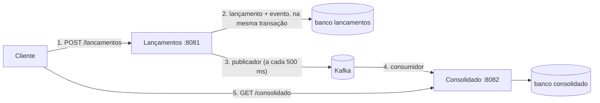

# Fluxo de Caixa

Controle de **lançamentos** (créditos e débitos) e **consolidado diário** (o saldo de cada dia), com dois serviços independentes que conversam **só por eventos**. É a resposta ao case do desafio de Arquiteto de Soluções: código Java, testes, arquitetura-alvo, decisões justificadas e como rodar. Se o Consolidado cair, o Lançamentos continua gravando.

> **Comandos de copiar e colar:** cada bloco traz o rótulo do terminal. Use **bash** no Linux, no macOS e no Git Bash do Windows, e **PowerShell** no Windows. Quando o comando é igual nos dois, o rótulo diz **bash e PowerShell**. No PowerShell, `bash` solto pode ser o do WSL: use o Git Bash, como mostrado.

## O que o case pediu e onde está

Estados: **provado** (teste ou script reproduzível), **medido** (número do [relatório de desempenho](docs/performance/relatorio.md)), **só desenho** (existe no desenho e não foi provisionado) e **pendente do GitHub** (falta o link do run). Detalhe em [`architecture.md` §1.2](docs/architecture/architecture.md).

| O case pediu | Onde está | Como conferir | Estado |
|---|---|---|---|
| Domínios e capacidades de negócio | [`01-domain-capabilities.md`](docs/specs/01-domain-capabilities.md) | ler | entregue |
| Requisitos funcionais e não funcionais refinados | [`02-requirements.md`](docs/specs/02-requirements.md) (RF-001 a RF-010, RNF-001 a RNF-014) | ler; cada um liga a um teste na [matriz](docs/specs/traceability.md) | entregue |
| Arquitetura-alvo completa | [`architecture.md` §6](docs/architecture/architecture.md) e [ADR-010](docs/architecture/decisions/ADR-010-plataforma-alvo-aws.md) | ler (diagrama AWS) | **só desenho** |
| Justificativa de tecnologias e arquitetura | [ADR-001 a ADR-011](docs/architecture/decisions/) (com alternativas rejeitadas) | ler | entregue |
| Linguagem à escolha | Java 25 e Spring Boot 4.1 | `./mvnw -v` | entregue |
| Testes | [`traceability.md`](docs/specs/traceability.md); testes em `*/src/test` | `./mvnw verify` ([guia](docs/guia/testes-e-qualidade.md)) | provado |
| README: como funciona e como rodar | este arquivo e [`docs/guia/`](docs/guia/README.md) | seção "Veja funcionando" | entregue |
| Repositório público e toda a documentação nele | este repositório, pasta `docs/` | abrir `docs/` | entregue |
| **Lançamentos não cai se o Consolidado cair** | [`demo.sh`](scripts/demo.sh) (passo do Consolidado parado) e `ConsolidadoParadoIT`, `KafkaForaIT` | etapa 5 abaixo | provado |
| **50 req/s no Consolidado, perda até 5 %** | [relatório de desempenho](docs/performance/relatorio.md): 15.001 requisições, 0 falhas, p95 de 6,3 ms (case local, 2026-10-25) | [guia de carga](docs/guia/carga-e-desempenho.md) | medido; `loadtest.yml` pendente do GitHub |
| Diferencial: arquitetura de transição | [`transition.md`](docs/architecture/transition.md) e [ADR-011](docs/architecture/decisions/ADR-011-arquitetura-de-transicao.md) | ler | **só desenho** (condicional) |
| Diferencial: estimativa de custos | [`docs/cost/estimativa.md`](docs/cost/estimativa.md) (export do AWS Pricing Calculator, 2026-10-26) | ler; os JSON estão em `docs/cost/pricing-calculator/` | estimativa, não medição |
| Diferencial: monitoramento e observabilidade | métricas, alertas e painel ([guia](docs/guia/observabilidade-e-alertas.md)); [ADR-008](docs/architecture/decisions/ADR-008-observabilidade.md) | profile `observability` | provado |
| Diferencial: segurança para consumo | [ADR-007](docs/architecture/decisions/ADR-007-seguranca-e-integracao.md); [OWASP](docs/security/owasp-mapping.md), [ameaças](docs/security/ameacas.md), [ASVS](docs/security/asvs-l1.md) | ler; testes de segurança na matriz | provado local; CodeQL, Dependency-Check e Trivy pendentes do GitHub |

## Veja funcionando em 5 etapas

Precisa de **Git**, **Docker ligado**, **Java 25** e **`jq`** (leitor de JSON da demo; no Windows: `winget install jqlang.jq` e abrir um terminal novo). Portas livres: `8081`, `8082`, `9081`, `9082`, e as do banco e do Kafka. No Windows, o script roda pelo Git Bash.

**1. Baixar o projeto**

**bash (Linux, macOS e Git Bash)**

```bash
git clone https://github.com/VictorLeaSilva/cashflow-platform.git
cd cashflow-platform
```

**PowerShell (Windows)**

```powershell
git -c core.longpaths=true clone https://github.com/VictorLeaSilva/cashflow-platform.git
cd cashflow-platform
```

**2. Criar o arquivo de configuração**

**bash (Linux, macOS e Git Bash)**

```bash
cp .env.example .env
```

**PowerShell (Windows)**

```powershell
Copy-Item .env.example .env
```

**3. Compilar e gerar as imagens** (a primeira vez baixa o *builder*, centenas de MB, e leva vários minutos)

**bash (Linux, macOS e Git Bash)**

```bash
./mvnw -q install -DskipTests -Pimagens
```

**PowerShell (Windows)**

```powershell
.\mvnw.cmd -q install "-DskipTests" "-Pimagens"
```

**4. Subir banco, Kafka e os dois serviços**

**bash e PowerShell**

```bash
docker compose --env-file .env -f deploy/docker-compose.yml --profile apps up -d --wait --remove-orphans
```

**5. Rodar a demonstração**

**bash (Linux, macOS e Git Bash)**

```bash
scripts/demo.sh
```

**PowerShell (Windows)**

```powershell
& "C:\Program Files\Git\bin\bash.exe" scripts/demo.sh
```

**O que você deve ver:** sete blocos com `✔` e, no fim, `Demonstração concluída: RF-007, RF-003, RF-009, RF-010 e RNF-001`. A demo prova idempotência, estorno, lançamento retroativo, isolamento entre comerciantes e o **Consolidado parado** (o Lançamentos segue gravando e o Consolidado converge quando volta). Com `--kafka-down` ela prova também o **Kafka parado**. Ela usa comerciantes novos a cada execução, então pode ser repetida.

**Para desligar** (acrescente `-v` para apagar os dados):

**bash e PowerShell**

```bash
docker compose --env-file .env -f deploy/docker-compose.yml --profile apps down
```

Quer o caminho manual, com três terminais, token e chamadas à API? Veja o [passo a passo](docs/guia/passo-a-passo.md). Algo deu errado? [Solução de problemas](docs/guia/solucao-de-problemas.md).

## Como funciona, em 5 passos



1. O cliente registra um lançamento no **Lançamentos**, com um token e uma chave de idempotência (repetir o pedido não duplica).
2. O serviço grava o lançamento **e** o evento numa tabela de saída (*outbox*) numa só transação: ou os dois existem, ou nenhum.
3. Um publicador lê essa tabela e envia o evento ao **Kafka**; se o Kafka estiver fora, o evento espera.
4. O **Consolidado** lê o evento, ignora repetidos e soma no dia do lançamento.
5. O cliente consulta o saldo do dia e o acumulado. Como os serviços nunca se chamam, o saldo pode levar cerca de 1 segundo para refletir um lançamento novo.

## Decisões principais

- **Dois serviços só por eventos, sem chamada entre eles:** o Lançamentos não depende do Consolidado ([ADR-001](docs/architecture/decisions/ADR-001-monorepo-e-dois-executaveis.md), [ADR-004](docs/architecture/decisions/ADR-004-kafka-e-contrato-de-evento.md)).
- **Outbox transacional e idempotência:** nenhum lançamento confirmado se perde, e repetição não duplica ([ADR-003](docs/architecture/decisions/ADR-003-outbox-publicador-idempotencia.md)).
- **Saldo por soma de movimentos, estorno como novo lançamento:** o fato financeiro nunca é editado ([ADR-005](docs/architecture/decisions/ADR-005-consistencia-eventual-e-projecao.md)).
- **PostgreSQL com SQL explícito (sem JPA) e arquitetura hexagonal enxuta, verificada por ArchUnit** ([ADR-002](docs/architecture/decisions/ADR-002-postgresql-jdbcclient-flyway.md), [ADR-009](docs/architecture/decisions/ADR-009-hexagonal-enxuta-archunit.md)).
- **JWT com escopos e isolamento por comerciante** ([ADR-007](docs/architecture/decisions/ADR-007-seguranca-e-integracao.md)); **métricas, alertas e painel** ([ADR-008](docs/architecture/decisions/ADR-008-observabilidade.md)).
- **Alvo na AWS (ECS, RDS Multi-AZ, MSK, Cognito), só desenho:** nada foi provisionado ([ADR-010](docs/architecture/decisions/ADR-010-plataforma-alvo-aws.md)).

## Resultados medidos

Medidos no **case local** (notebook, gerador de carga e serviços na mesma máquina, uma rodada por taxa, um comerciante). **Não** valem para o alvo na AWS. Detalhe e limitações no [relatório](docs/performance/relatorio.md).

| O que | Resultado |
|---|---|
| Leitura do consolidado a 50 req/s por 5 min (o pedido do case) | 15.001 requisições, 0 falhas, p95 de 6,3 ms |
| Leitura a 100 e a 200 req/s (informativo) | 0 falhas nas duas; o teto não foi encontrado |
| Atraso entre o lançamento e o consolidado (p95) | 0,69 s (meta: até 5 s) |
| Custo mensal estimado do alvo ([estimativa](docs/cost/estimativa.md)) | cerca de 790 USD (MVP) e 1.966 USD (produção resiliente) |

## O que eu faria com mais tempo

- **Provar o alvo:** infraestrutura como código, multi-AZ, *failover* e restauração (hoje só desenho, [ADR-010](docs/architecture/decisions/ADR-010-plataforma-alvo-aws.md)).
- **Medir o que faltou:** a drenagem de um acúmulo de eventos sob leitura, histórico longo, vários comerciantes e o teto de capacidade ([relatório](docs/performance/relatorio.md), [arquitetura §11](docs/architecture/architecture.md)).
- **Reconstruir o consolidado** a partir dos lançamentos e guardar saldos periódicos quando o histórico crescer ([ADR-006](docs/architecture/decisions/ADR-006-estrategia-de-rebuild.md), [ADR-005](docs/architecture/decisions/ADR-005-consistencia-eventual-e-projecao.md)).
- **Trocar o polling por CDC** se a latência de publicação pesar, e usar registro de esquemas com mais consumidores ([ADR-003](docs/architecture/decisions/ADR-003-outbox-publicador-idempotencia.md), [ADR-004](docs/architecture/decisions/ADR-004-kafka-e-contrato-de-evento.md)).
- **Identidade real** (Cognito ou Keycloak) no lugar do token de desenvolvimento ([ADR-007](docs/architecture/decisions/ADR-007-seguranca-e-integracao.md)).
- **Fechar as lacunas da revisão final:** *timeouts* dos pools, contagem do conflito de idempotência na métrica e a saída das *tasks* para a internet no desenho ([arquitetura §11](docs/architecture/architecture.md), [custos](docs/cost/estimativa.md)).
- **Registrar os runs verdes do GitHub** (`security.yml`, `loadtest.yml`, `demo.yml`) para promover os itens "pendente do GitHub".
- **Cortado por escopo:** ZAP, mutação com PIT e o IdP local com Keycloak ([backlog](docs/specs/06-tasks.md)).

## Mapa da documentação e trilha de leitura

- **5 minutos:** este README.
- **15 minutos:** os diagramas e a visão geral em [`architecture.md`](docs/architecture/architecture.md) e o [passo a passo](docs/guia/passo-a-passo.md).
- **1 hora:** os [ADRs](docs/architecture/decisions/), a [especificação](docs/specs/), a [segurança](docs/security/), a [carga](docs/performance/relatorio.md), os [custos](docs/cost/estimativa.md) e a [transição](docs/architecture/transition.md).

| Pasta | O que tem |
|---|---|
| [`docs/guia/`](docs/guia/README.md) | Guias de uso: passo a passo, observabilidade, carga, bancos e contêineres, problemas, testes e glossário |
| [`docs/architecture/`](docs/architecture/) | Arquitetura (C4, runtime, deploy, alvo AWS), 11 ADRs e a transição |
| [`docs/specs/`](docs/specs/) | Especificação, requisitos, contratos, backlog, revisões e a matriz de rastreabilidade |
| [`docs/security/`](docs/security/), [`docs/cost/`](docs/cost/), [`docs/performance/`](docs/performance/), [`docs/runbooks/`](docs/runbooks/) | Segurança, custos, medições e o runbook da DLT |
| `lancamentos-service/`, `consolidado-service/`, `contracts/` | Os dois serviços e o contrato do evento (JSON Schema); as APIs estão em `*/src/main/resources/openapi/` |

O projeto segue Spec Driven Development, com revisão independente por tarefa: veja o [método de desenvolvimento](docs/guia/metodo-de-desenvolvimento.md).
