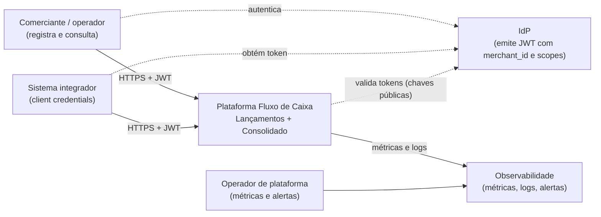
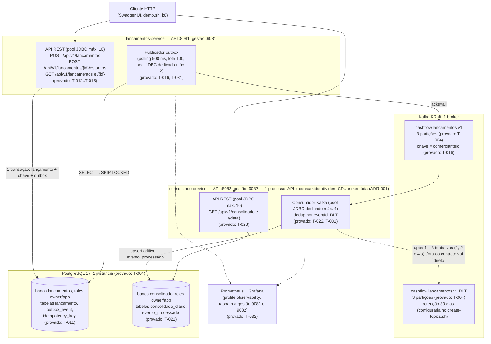
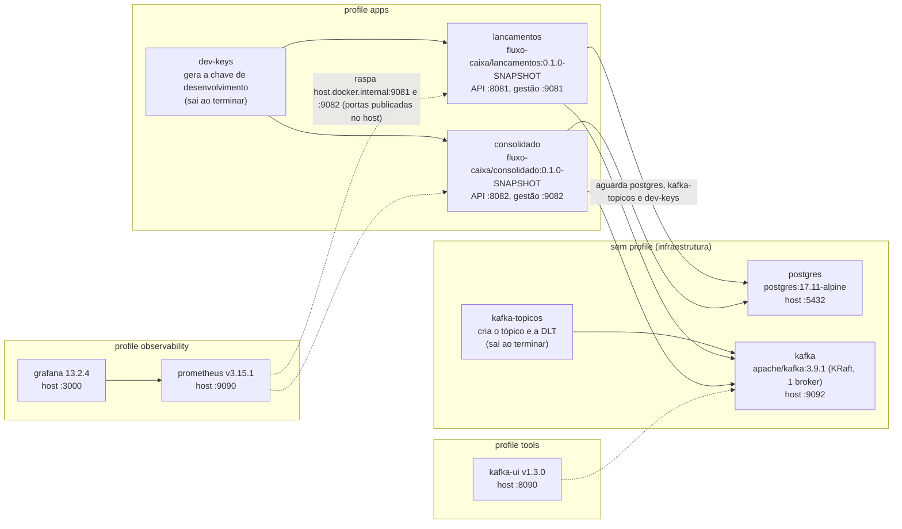
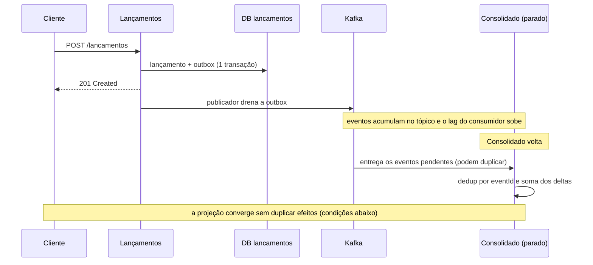
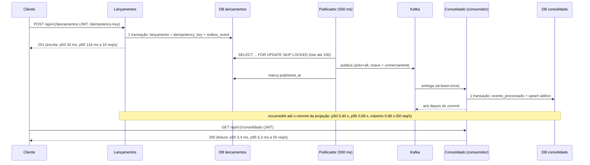
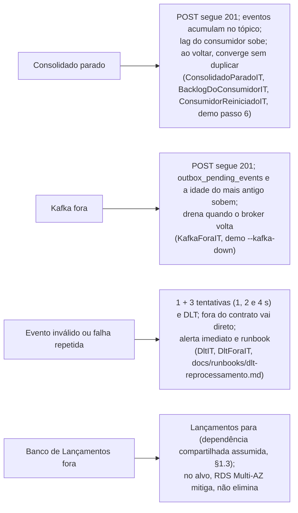
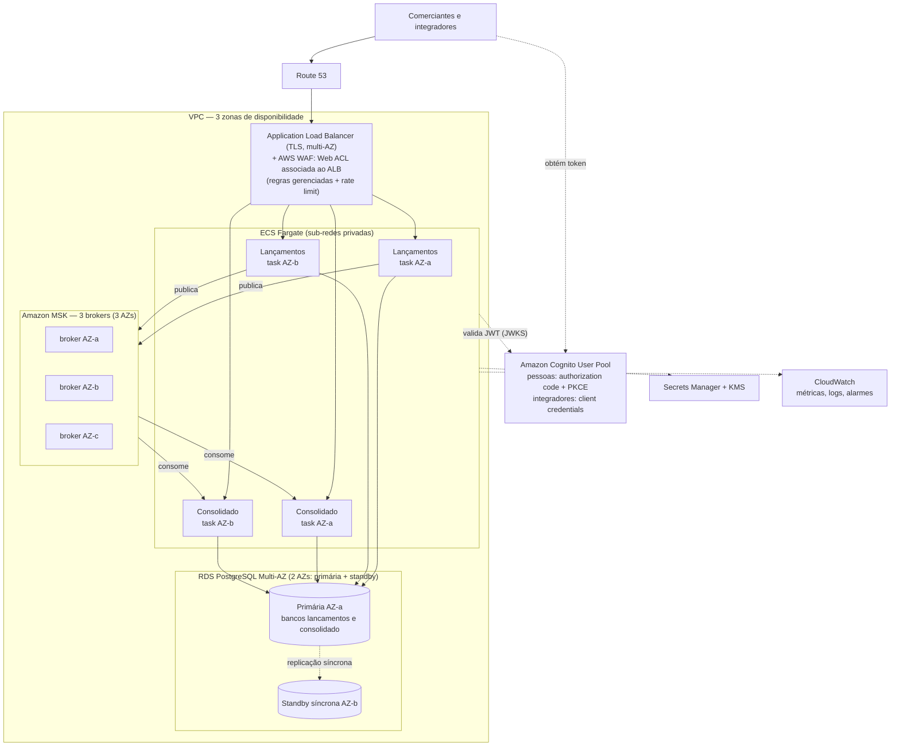

# Arquitetura — Fluxo de Caixa

> Documento de arquitetura do case. A T-005 criou os direcionadores, os diagramas C4, a arquitetura-alvo e as decisões (ADRs). A T-040 atualizou os estados para o que foi construído e provado (M1 a M3), acrescentou as visões de **runtime** (§5.2) e de **deploy local** (§4.1) com números medidos e fez a revisão cruzada ADRs × código (§11).
>
> **Leitura rápida dos rótulos:** *provado* = há teste ou script reproduzível e evidência revisada; *medido* = número do [relatório de desempenho](../performance/relatorio.md) (2026-10-25, notebook local, gerador de carga e serviços na mesma máquina) e **vale só para o case local, não para o alvo**; *meta* = objetivo do alvo AWS, não medido; *só desenho* = existe apenas no alvo.

## 1. Visão geral

Um comerciante registra **lançamentos** (créditos e débitos) e consulta o **saldo diário consolidado**. A solução tem dois serviços que se comunicam **apenas por eventos**:

- **Lançamentos** registra os fatos financeiros (imutáveis; correção é estorno) e publica `LancamentoRegistrado.v1`.
- **Consolidado** consome esses eventos, mantém o movimento diário por comerciante e responde as consultas de saldo.

### 1.1 Direcionadores

| Requisito do enunciado | Como a arquitetura responde | Princípio |
|---|---|---|
| Serviço de lançamentos e serviço de consolidado | Dois executáveis independentes, um banco lógico cada (ADR-001, ADR-002) | P2 |
| Lançamentos não pode cair se o Consolidado cair | Nenhuma chamada síncrona entre serviços; outbox transacional + Kafka (ADR-003). Limites da garantia em §1.3 | P6 |
| 50 req/s no Consolidado em pico, "no máximo 5 % de perda de requisições" | Leitura em projeção pré-agregada (os dias por chave; o saldo anterior soma o histórico, §5.2); serviços *stateless* escaláveis; **medido** com k6 (RNF-002, T-033): 0 falhas em 15 001 leituras a 50 req/s, p95 de 6,3 ms (§5.2). "Perda" aqui é **taxa de requisições HTTP com falha** (erro ≥ 500, erro de conexão ou resposta > 2 s, RNF-002) — não perda de lançamentos ou eventos. Lançamento confirmado com 201 não é descartado pelo fluxo: fica no banco, e o evento fica na outbox até ser publicado (ADR-003). Os casos de perda de dados restantes são de infraestrutura (restauração por PITR, perda da região) e estão no ADR-010 | P8 |
| Dinheiro e saldo corretos | `BigDecimal`/`NUMERIC`; fatos imutáveis; idempotência fim a fim (ADR-003, ADR-005) | P3, P4, P5 |
| Segurança | JWT, *scopes*, isolamento por comerciante, critérios de integração (ADR-007) | — |
| Documentação e decisões | ADR-001..010, specs em `docs/specs/` | P7, P9 |

### 1.2 Case local × arquitetura-alvo

| | **Case local** (implementado e provado, tarefa a tarefa) | **Arquitetura-alvo AWS** (apenas desenho) |
|---|---|---|
| O que é | Código, testes, `docker compose` com PostgreSQL e Kafka (e, em profiles, os dois serviços, Prometheus e Grafana), k6, `scripts/demo.sh` | Diagrama e decisões para produção (§6, ADR-010) |
| Evidência | `./mvnw verify` (gates, ITs com Testcontainers, ArchUnit), `deploy/verify-local.sh` (T-004), testes de resiliência (T-031), `scripts/demo.sh` (T-035), resultados do k6 em `docs/performance/results/` (T-033), matriz `docs/specs/traceability.md` | Justificativa e trade-offs; números rotulados como **meta** |
| Nuvem | Nenhuma: não há conta AWS, IaC nem deploy | ECS, RDS, MSK, Cognito, CloudWatch — só no desenho |

Este documento usa quatro estados, e nada é afirmado além do estado indicado:

| Estado | Significado | Exemplos hoje |
|---|---|---|
| **Provado** | Existe no repositório e há teste ou script reproduzível, com evidência em `docs/specs/reviews/T-xxx.evidence.md` e revisão PASS | APIs, publicador, consumidor, JWT, métricas, retry e DLT, idempotência concorrente, resiliência com o Consolidado parado e com o Kafka fora (§8) |
| **Medido** | Número do relatório de desempenho, com data e ambiente | 50, 100 e 200 req/s de leitura; frescor da projeção (§5.2) |
| **Pendente do GitHub** | Implementado e verificado localmente, mas a prova final é um *run* no GitHub que só o autor confirma | `security.yml` verde no PR (CodeQL, Dependency-Check, Trivy), `loadtest.yml` e `demo.yml` (RNF-005, RNF-002) |
| **Só desenho** | Existe apenas na arquitetura-alvo; não será provado no case | Multi-AZ, *failover*, RPO/RTO, WAF, Cognito, CloudWatch |

**Regra para mudar um item para "provado":** só com evidência reproduzível registrada — o comando ou teste que prova (`classe#método`, script, cenário k6) e o arquivo de evidência da tarefa (`docs/specs/reviews/T-xxx.evidence.md`) com a revisão independente. Testes de risco contam como prova só na forma exigida (por exemplo, idempotência **concorrente**, não apenas sequencial — `04 §2.7`); carga conta só com resultado medido e versionado (`docs/performance/results/`). Ao concluir cada tarefa, esta tabela e as de §7 e §8 são atualizadas (a T-040 fez a atualização geral até a T-038).

As metas da arquitetura-alvo (§6) **nunca** viram "provado" por causa do case local: k6 local mede o código no ambiente local, não o comportamento de ECS, RDS e MSK.

### 1.3 Limites da garantia de disponibilidade (RNF-001)

O desacoplamento assíncrono impede que a queda do **processo** do Consolidado, ou do seu consumidor, interrompa o registro de lançamentos. A garantia **depende** da disponibilidade do banco de Lançamentos e da capacidade de gravar na outbox. O que ela cobre e o que não cobre:

| Falha | Efeito em Lançamentos | Observação |
|---|---|---|
| Processo do Consolidado (API ou consumidor) parado | Segue registrando (201) | Eventos acumulam no Kafka; o consolidado converge quando volta |
| Kafka indisponível | Segue registrando (201) | A outbox cresce; o publicador falha rápido com pool próprio e não bloqueia o HTTP (`03 §7.1`) |
| Indisponibilidade prolongada do Kafka | Segue registrando, com risco crescente | A outbox não tem limite de tamanho: uma falha longa pode saturar o banco. Mitigação: alerta por idade da outbox (ADR-008) e ação operacional |
| Instância PostgreSQL compartilhada indisponível ou saturada | **Para** (os dois serviços) | Dependência compartilhada assumida (D-15, ADR-002); no alvo, mitigada por RDS Multi-AZ, não eliminada |

Separar fisicamente todos os recursos não é necessário para o enunciado; o que importa é declarar o limite da garantia e monitorá-lo.

## 2. Domínios e capacidades

Detalhe em [`01-domain-capabilities.md`](../specs/01-domain-capabilities.md).

| Contexto | Tipo | Capacidades |
|---|---|---|
| **Lançamentos** | Core | Registrar crédito/débito (inclusive retroativo até 30 dias), estornar, consultar histórico, garantir idempotência, publicar fatos |
| **Consolidado** | Core (suporte à decisão) | Aplicar fatos ao movimento diário, consultar o dia e o intervalo, calcular saldo acumulado, medir o frescor da projeção |
| Identidade e acesso | Genérico | IdP externo emite JWT com `merchant_id` e *scopes* |
| Mensageria, observabilidade | Genérico | Plataforma |

Relação entre contextos: Lançamentos publica uma *Published Language* (evento versionado com JSON Schema); o Consolidado é *Conformist* a esse contrato. Não há código compartilhado entre os serviços.

## 3. Contexto (C4 nível 1)

## 4. Contêineres do case local (C4 nível 2)

**Estado do case:** o diagrama mostra o case local completo e cada elemento está **provado** na tarefa indicada (testes na matriz `docs/specs/traceability.md`, evidência em `docs/specs/reviews/T-xxx.evidence.md`). A infraestrutura (PostgreSQL com bancos e roles isolados por `CONNECT`, Kafka com tópico e DLT) é verificada por `deploy/verify-local.sh` (T-004). As portas de gestão (9081 e 9082) expõem só `health` e `prometheus`, sem autenticação, e servem ao Prometheus; o compose as publica no host apenas para uso local (ver §4.1).

### 4.1 Visão de deploy local

O `deploy/docker-compose.yml` organiza os contêineres em *profiles*; sem profile sobem só a infraestrutura. Tags de imagem fixas; senhas vêm do `.env` (fora do Git), e o compose falha sem elas.

| Profile | Contêineres | Para que serve | Representa no alvo |
|---|---|---|---|
| (nenhum) | `postgres`, `kafka`, `kafka-topicos` | Infraestrutura para rodar os serviços pelo Maven (`spring-boot:run`) ou pelos testes | RDS Multi-AZ e MSK (ADR-010) |
| `apps` | `dev-keys`, `lancamentos`, `consolidado` | Os dois serviços em imagens Paketo (usuário não-root `1002:1001`), com o profile Spring `local`; usado pela demo e pelo k6 | ECS Fargate com ≥ 2 *tasks* por serviço |
| `observability` | `prometheus`, `grafana` | Métricas, alertas (`deploy/prometheus/alertas.yml`, com regras checadas e testadas por `promtool` no CI) e painéis. O Prometheus raspa `host.docker.internal:9081` e `:9082`, ou seja, as portas publicadas no host | CloudWatch |
| `tools` | `kafka-ui` | Inspecionar tópicos e a DLT | — |

**O que o deploy local não prova:** multi-AZ, *failover*, WAF, TLS e IdP gerenciado (§7). Os mapeamentos de porta do compose (Postgres, Kafka, gestão dos serviços) valem para uso local e não são exposição de produção; no alvo, só o ALB é público e a gestão fica na rede privada (ADR-010). Os limites de CPU e memória por contêiner **não** estão definidos no compose (o relatório de desempenho rodou sem limites, com 12 CPUs e 8,2 GB para o Docker inteiro).

## 5. Fluxos principais

Os diagramas de sequência do registro e do consumo estão em [`03-design-contracts.md §2`](../specs/03-design-contracts.md). O cenário que motiva a arquitetura — **Consolidado fora do ar** — fica assim:

A projeção converge sem duplicar os efeitos dos eventos, **desde que** os eventos persistidos (na outbox ou no tópico, dentro da retenção) sejam recuperáveis e o processamento seja retomado com sucesso. Falhas que quebram essas condições — perda da instância de banco, evento na DLT aguardando reprocessamento, retenção excedida — estão em §1.3, no ADR-005 e no ADR-010.

Com o **Kafka** fora, o comportamento é o mesmo do ponto de vista do cliente: o `POST` segue 201 e quem acumula é a **outbox**, que drena quando o broker volta (`03 §7`). Os dois cenários estão **provados** no case local: `ConsolidadoParadoIT#postsSeguem201SemConsumidorEOsEventosFicamNoTopico` e `KafkaForaIT` (lancamentos-service), `BacklogDoConsumidorIT` e `ConsumidorReiniciadoIT` (consolidado-service), e os passos da demo `scripts/demo.sh` e `scripts/demo.sh --kafka-down` (T-031 e T-035, evidências em `docs/specs/reviews/`). Os limites dessa garantia estão em §1.3.

### 5.1 Estorno no fluxo de eventos

O estorno não edita nem apaga o lançamento original: é um **novo lançamento** do tipo `ESTORNO`, com `id` e `eventId` próprios, `referenciaLancamentoId` apontando o original e `tipoOriginal` (`03 §4`). Ele percorre o mesmo caminho — mesma transação com a outbox, mesmo tópico, mesmo consumidor — e produz efeito **na data do estorno** (ADR-005).

Exemplo: crédito de R$ 100,00 em 15/10, estornado em 22/10.

| Evento | `eventId` | Efeito na projeção | `saldoDia` |
|---|---|---|---|
| `CREDITO` 100.00 (15/10) | E1 | 15/10: `total_creditos += 100.00` | 15/10: +100.00 |
| `ESTORNO` de crédito 100.00 (22/10) | E2 | 22/10: `total_estornos_credito += 100.00` | 22/10: −100.00 |

O crédito continua no histórico de 15/10; o saldo acumulado a partir de 22/10 volta ao valor anterior ao crédito. A deduplicação é por `eventId`: reentregas de E2 são ignoradas, mas E2 **não** é descartado por referenciar um lançamento que já foi processado (E1). O estorno único por lançamento é garantido em Lançamentos, por índice único (AC-003.5), não no consumidor.

### 5.2 Visão de runtime (comportamento medido no case local)

> Todos os números desta seção vêm do [relatório de desempenho](../performance/relatorio.md) (T-033, 2026-10-25, notebook Intel Core i5-1334U com Docker Desktop de 12 CPUs e 8,2 GB, profile `apps` sem limite por contêiner, `grafana/k6:1.7.0` na mesma máquina, **uma rodada por taxa**, um comerciante, 30 dias de histórico). Medem o código e o desenho no ambiente local; **não** medem ECS, RDS nem MSK e **não** são previsão para o alvo.

#### Caminho de escrita e de consumo

#### Números medidos

| Item | Resultado | Fonte |
|---|---|---|
| Leitura a 50 req/s por 5 min (oficial) | 15 001 requisições, 0 falhas; p50 3,4 ms, p95 6,3 ms, p99 9,4 ms, máximo 22,3 ms | `load-50rps-20261025T095711Z.json` |
| Escrita simultânea a 10 req/s | 3 001 requisições, 0 falhas; p50 34,0 ms, p95 117,6 ms, p99 171,1 ms, máximo 333,0 ms | idem |
| Leitura a 100 e a 200 req/s (informativas, RNF-010) | 0 falhas em 30 001 e em 60 001 requisições; p95 de 4,7 ms e de 4,9 ms; `dropped_iterations` = 0 | `load-100rps-…json`, `load-200rps-…json` |
| Frescor da projeção (RNF-003) | p95 de 0,69 s, 0,69 s e 0,61 s e máximo de 0,98 s, 2,22 s e 0,88 s (50, 100 e 200 req/s); p95 é aproximado pelos buckets do histograma | `*.lag.json` |
| Outbox em operação | no máximo 7 eventos pendentes e o mais antigo com menos de 0,75 s; 0 falhas de publicação; 0 eventos na DLT | `*.lag.json` |
| Pools JDBC (picos de raspagens de 5 s) | no máximo 1 conexão ativa por pool (API do Lançamentos, máx. 10; publicador, 2; consumidor, 4) e 0 na API do Consolidado (máx. 10); 0 conexões pendentes | `*.lag.json` |
| Lag do consumidor Kafka (pico) | 0 registros nas três taxas | `*.lag.json` |
| CPU do contêiner do Consolidado (média e pico) | 0,21 e 0,52 núcleo (50 req/s); 0,39 e 0,67 (200 req/s) | `*.stats.txt` |
| Memória (pico) | Lançamentos 327 a 365 MiB, Consolidado 368 a 371 MiB | `*.stats.txt` |

**Como ler:** o teto do sistema **não** foi encontrado (não houve teste de estresse), e o histórico longo e vários comerciantes não foram medidos. Em particular, o saldo anterior soma o histórico do comerciante (`ConsultaConsolidadoJdbcRepository`), então a latência de leitura cresce com o histórico; a medição usou 60 lançamentos de *seed*. Os limiares de alerta (ADR-008) e os limites de resiliência (`03 §7.1`) foram revistos com estes números e **mantidos**.

#### Falhas (provadas, sem número de desempenho)

## 6. Arquitetura-alvo AWS (apenas desenho)

> Nada desta seção é provisionado. É o desenho de produção pedido no enunciado; decisões e alternativas em [ADR-010](decisions/ADR-010-plataforma-alvo-aws.md). Números são **metas a validar** (RNF-011), não garantias dadas pela escolha dos serviços. O diagrama é de alto nível: sub-redes, *security groups* e rotas estão na tabela e no ADR-010, não no desenho.

| Componente | Responsabilidade | RNF atendido | Meta |
|---|---|---|---|
| Route 53 + ACM | DNS da API e certificados TLS da borda | RNF-005, RNF-011 | — |
| ALB + AWS WAF (Web ACL associada ao ALB) | TLS e distribuição entre AZs (ALB); filtragem e *rate limit* por cliente nas requisições que chegam ao ALB (WAF) | RNF-005, RNF-010 | — |
| VPC (sub-redes públicas para o ALB, privadas para ECS/RDS/MSK, *security groups* por serviço) | Isolamento de rede; só o ALB é exposto | RNF-005, RNF-011 | — |
| ECS Fargate (≥ 2 *tasks* por serviço em 2+ AZs, *auto scaling*) | Executar os serviços *stateless* e escalar horizontalmente | RNF-001, RNF-002, RNF-010, RNF-011 | Lançamentos 99,9 %/mês; Consolidado 99,5 %/mês |
| RDS PostgreSQL Multi-AZ (primária + standby em 2 AZs) + PITR | Fonte de verdade e projeção; *failover* automático entre AZs; PITR para corrupção ou erro lógico | RNF-004, RNF-011 | RPO 5 min e RTO 30 min, por cenário no ADR-010 |
| MSK (3 brokers em 3 AZs, RF 3, `min.insync` 2) | Transporte durável de eventos, acúmulo durante falhas; tolera a perda de um broker | RNF-001, RNF-003, RNF-007, RNF-011 | Por cenário no ADR-010 |
| Cognito | Identidade de pessoas (*authorization code* + PKCE) e de integradores (*client credentials*), com `merchant_id` no token (ADR-007) | RNF-005 | — |
| Secrets Manager + KMS | Credenciais e criptografia em repouso | RNF-005 | — |
| CloudWatch | Métricas, logs e alarmes (ADR-008) | RNF-006 | — |

**Ponto de partida medido, não prova.** O case local mediu o código, não o alvo (§5.2). Os números abaixo servem para dimensionar a primeira configuração do alvo, e cada um continua uma **meta a validar** no ambiente real:

| Meta ou premissa do alvo | Número medido no case local | Limite da leitura |
|---|---|---|
| Consolidado atende 50 req/s com < 5 % de falha (RNF-002) | 0 falhas a 50, 100 e 200 req/s; p95 de leitura entre 4,7 e 6,3 ms; Consolidado usou no máximo 0,67 núcleo a 200 req/s | Um comerciante, 60 lançamentos de *seed*, gerador na mesma máquina; sem teste até a quebra |
| Frescor da projeção p95 ≤ 5 s (RNF-003) | p95 de 0,61 a 0,69 s e máximo de 2,22 s | O Kafka local tem 1 broker; a replicação do MSK (3 brokers, `acks=all`, `min.insync` 2) pode acrescentar latência de publicação que esta medição não vê |
| Serviços *stateless* escalam horizontalmente (RNF-010) | A latência de leitura não cresceu de 50 a 200 req/s | Escala horizontal e *auto scaling* não foram exercitados; só desenho |
| Pools e tamanho das *tasks* | Pico de 1 conexão por pool; contêineres de 330 a 370 MiB | Sem limite de CPU ou memória no compose; o dimensionamento das *tasks* do Fargate fica para a validação no ambiente real |

**Estimativa de custo mensal (não é medição).** A estimativa do desenho acima, exportada do AWS Pricing Calculator em 2026-10-26 para a região `sa-east-1`, está em [`docs/cost/estimativa.md`](../cost/estimativa.md): do MVP à produção resiliente, com a comparação MSK provisionado × Serverless e as lacunas do desenho (por exemplo, a saída das *tasks* para a internet, que o ADR-010 não cobre).

## 7. Do case local ao alvo

Estados conforme §1.2: **provado**, **medido**, **pendente do GitHub** e **só desenho**. As provas são testes da matriz `docs/specs/traceability.md` (classe, módulo) e as evidências `docs/specs/reviews/T-xxx.evidence.md`.

| Peça do case local | Representa no alvo | Estado no case local |
|---|---|---|
| Serviços (`lancamentos-service`, `consolidado-service`), imagens Paketo com usuário não-root | ECS Fargate com ≥ 2 *tasks* por serviço | Comportamento da aplicação: **provado** (T-010..T-023 e T-031; E2E na T-031, demo na T-035). Usuário não-root das imagens: **provado** (T-035, `docker inspect`). Multi-AZ e *auto scaling*: **só desenho** |
| PostgreSQL 17 no compose, 2 bancos e 4 roles | RDS PostgreSQL Multi-AZ com a mesma topologia | Bancos e isolamento de `CONNECT`: **provado** (T-004). Imutabilidade por *grants* em `lancamento`: **provada** (T-011, `MigracaoEPermissoesIT`, `ConstraintsLancamentoIT`). *Failover*, PITR, RPO/RTO: **só desenho** |
| Kafka KRaft com 1 broker | MSK com 3 brokers em 3 AZs | Tópico e DLT com 3 partições: **provado** (T-004). Publicação, acúmulo, consumo e reprocessamento: **provados** (T-016, T-022, T-031: `KafkaForaIT`, `ConsolidadoParadoIT`, `DltIT`, `DltForaIT`). Replicação entre AZs: **só desenho** |
| Chave de dev + `scripts/DevToken.java` | Cognito | Validação de JWT, *scopes* e isolamento por comerciante: **provados** (`SegurancaJwtWebTest`, `DevTokenIT`, `IsolamentoPorComercianteIT`; T-013, T-015, T-023). IdP local (Keycloak, T-036): cortado; IdP gerenciado: **só desenho** |
| Cabeçalhos seguros, CORS fechado, limites de cabeçalho e `OPTIONS` → 405 nos serviços | TLS, HSTS, WAF e *rate limit* no ALB | Cabeçalhos, CORS, limites e `OPTIONS`: **provados** (T-034: `CabecalhosDeSegurancaWebTest`, `CorsEOptionsWebTest`, `LimitesHttpWebTest`). TLS, HSTS, WAF, *rate limit*: **só desenho** |
| `.env` local (fora do Git) | Secrets Manager + KMS | Senhas fora do repositório: **provado** (T-004, compose falha sem as variáveis). Gestão de segredos e KMS: **só desenho** |
| Prometheus + Grafana (profile `observability`) | CloudWatch | Métricas, logs com `requestId` e `traceId`, regras de alerta: **provados** (T-032: `GestaoActuatorWebTest`, `MetricasDosPoolsEDoKafkaIT`, `RastroDoConsumoIT`; regras checadas e testadas por `promtool` no CI). CloudWatch: **só desenho** |
| k6 local (`loadtest/`) | Carga contra o ambiente real | Carga de 50 req/s e rodadas de 100 e 200 req/s: **medidas** (T-033, §5.2); medem o código, não a infraestrutura-alvo. `loadtest.yml` no GitHub: **pendente do GitHub** |
| CodeQL, Dependency-Check, Trivy (`security.yml`), Dependabot | O mesmo pipeline de CI; nada específico do alvo foi desenhado para isto | Workflows e supressões com validade: existem (T-034, T-037, T-038). O resultado verde de cada job num PR é **pendente do GitHub** |

## 8. Requisitos não funcionais: mecanismo e verificação

Cada estado cita a prova. Onde há `@Tag`, a lista completa de testes por requisito está em [`traceability.md`](../specs/traceability.md).

| RNF | Mecanismo | Como é verificado | Estado hoje |
|---|---|---|---|
| RNF-001 Isolamento de falha | Nenhuma chamada síncrona; outbox + Kafka; eventos acumulam no Kafka com o Consolidado parado. Limites em §1.3 | `ConsolidadoParadoIT`, `KafkaForaIT`, `BacklogDoConsumidorIT`, `ConsumidorReiniciadoIT`; `scripts/demo.sh` | **Provado** (T-031, T-035) |
| RNF-002 Capacidade do Consolidado (50 req/s, taxa de requisições com falha < 5 %) | Leitura de uma projeção pré-agregada; pools dimensionados; serviço *stateless* | k6 `loadtest/load.js` com *thresholds*; `docs/performance/relatorio.md` | **Medido**: 0 falhas em 15 001 requisições, p95 de 6,3 ms (T-033). `loadtest.yml` no GitHub: pendente do GitHub |
| RNF-003 Frescor da projeção (meta p95 ≤ 5 s) | Publicador a cada 500 ms e consumidor contínuo; tempo total inclui *polling*, publicação, entrega, lote, gravação e filas | Histograma `consolidado_event_lag_seconds` (`occurredAt` até o commit da projeção), testado por `HistogramaDoLagTest` e `MetricasDoConsumidorIT`; medido sob carga | **Medido**: p95 de 0,69 s e máximo de 2,22 s (T-033). p95 aproximado pelos buckets |
| RNF-004 Integridade e não duplicidade | `Idempotency-Key` + FK diferida; `eventId` + `evento_processado`; índices únicos | `IdempotenciaConcorrenteIT`, `EstornoConcorrenteIT`, `DeduplicacaoConcorrenteIT`, `ProjecaoPostgresPropertiesIT`, `FalhaEntreEnvioEMarcacaoIT` | **Provado** (T-011, T-012, T-014, T-016, T-021, T-022) |
| RNF-005 Segurança | JWT validado, *scopes*, comerciante só do token, cabeçalhos e limites, gates de segurança | `SegurancaJwtWebTest`, `CabecalhosDeSegurancaWebTest`, `LimitesHttpWebTest`, `DependenciasSemCveTest`, `IsolamentoPorComercianteIT` | Código e testes **provados** (T-013, T-015, T-023, T-034, T-037). Gates CodeQL, Dependency-Check e Trivy: **pendente do GitHub** (o repositório não guarda o link dos *runs*; o Dependency-Check aguarda o run da T-038) |
| RNF-006 Observabilidade | Métricas de fluxo, logs JSON com `requestId` e `traceId`, alertas (ADR-008) | `GestaoActuatorWebTest`, `MetricasDeNegocioWebTest`, `PoolsMetricasIT`, `RastroDoEventoIT`; regras de alerta testadas por `promtool` | **Provado** (T-032) |
| RNF-007 Resiliência a falha do broker | Outbox cresce, pool dedicado do publicador, *backoff* | `KafkaForaIT`, `FalhaEntreEnvioEMarcacaoIT`, `DltForaIT`, `MetricasOutboxIT`; `scripts/demo.sh --kafka-down` | **Provado** (T-016, T-031, T-035) |
| RNF-008 Qualidade | Gates G1–G3, ArchUnit, cobertura | `./mvnw verify` (formato, Checkstyle, SpotBugs, ArchUnit, JaCoCo); `scripts/verify-task.sh` e `scripts/test/run-tests.sh` | G2 e o harness **provados** (T-002, T-003). G1 (gitleaks) e G3 existem em `ci.yml` e `security.yml`; o verde no GitHub é **pendente do GitHub** |
| RNF-009 Operabilidade local | Compose + README em ≤ 5 comandos | README executado em bash e em PowerShell, em clone limpo e stack isolada (T-007, T-035) | **Provado** nas tarefas indicadas; a prova final em clone limpo é a T-043 |
| RNF-010 Escalabilidade | Serviços *stateless*; escala horizontal no alvo | k6 informativo a 100 e 200 req/s | **Medido** (T-033): mesmos limiares, sem falhas; o teto não foi encontrado. Escala horizontal no alvo: **só desenho** |
| RNF-011 Disponibilidade e DR (**metas**) | Multi-AZ, PITR, MSK replicado (§6, ADR-010) | Restauração testada quando houver ambiente | **Só desenho** |
| RNF-012 Rastreabilidade de requisição | Filtro `X-Request-Id` (aceita válido ou gera), cabeçalho em toda resposta, MDC, outbox e cabeçalho Kafka (`03 §5.2`, ADR-008) | `RequestIdWebTest`, `RastroDoEventoIT`, `RastroDoConsumoIT`, `LogsDoConsumidorIT` | **Provado** (T-013 a T-016, T-022, T-023, T-032) |
| RNF-013 Validação estrita de entrada | Rejeitar sem alterar: 415/406/413, controle e espaços nas pontas, NFC antes do hash, datas estritas (`03 §5.2`, ADR-007) | `ValidacaoEstritaWebTest`, `DatasEstritasWebTest`, `GetConsolidadoWebTest` | **Provado** (T-012, T-013, T-023, T-034) |
| RNF-014 Contrato documentado e verificado | OpenAPI com exemplos em todos os status, validados contra o schema | `OpenApiExemplosTest`, `ContratoRespostasWebTest`, `InventarioDeRotasTest` | **Provado** (T-013, T-023) |

## 9. Decisões (ADRs)

| ADR | Decisão |
|---|---|
| [001](decisions/ADR-001-monorepo-e-dois-executaveis.md) | Monorepo e dois executáveis independentes |
| [002](decisions/ADR-002-postgresql-jdbcclient-flyway.md) | PostgreSQL + `JdbcClient` + Flyway; sem cache |
| [003](decisions/ADR-003-outbox-publicador-idempotencia.md) | Outbox transacional, publicador por *polling* e idempotência HTTP |
| [004](decisions/ADR-004-kafka-e-contrato-de-evento.md) | Kafka vs alternativas; contrato JSON + JSON Schema |
| [005](decisions/ADR-005-consistencia-eventual-e-projecao.md) | Consistência eventual e projeção comutativa; estorno compensatório |
| [006](decisions/ADR-006-estrategia-de-rebuild.md) | Estratégia de rebuild da projeção (fora do MVP) |
| [007](decisions/ADR-007-seguranca-e-integracao.md) | Modelo de segurança e critérios de integração |
| [008](decisions/ADR-008-observabilidade.md) | Observabilidade |
| [009](decisions/ADR-009-hexagonal-enxuta-archunit.md) | Hexagonal enxuta + ArchUnit |
| [010](decisions/ADR-010-plataforma-alvo-aws.md) | Plataforma-alvo AWS (desenho, não implementado) |
| [011](decisions/ADR-011-arquitetura-de-transicao.md) | Arquitetura de transição (condicional, não implementada); resumo em [`transition.md`](transition.md) |

## 10. Evolução e o que ficou de fora

Fora do escopo do case, com o caminho de evolução registrado (`00 §7`):

| Item | Por que ficou fora | Evolução |
|---|---|---|
| Rebuild administrativo da projeção | Risco alto para o ganho no MVP | Reemitir a partir de `lancamento` (ADR-006) |
| CDC com Debezium | Polling atende a latência do case | Se a latência de publicação pesar (ADR-003) |
| Cache distribuído / réplica de leitura | Sem medição que justifique (A9) | Se o k6 mostrar saturação (ADR-002) |
| Schema Registry | Um produtor e um consumidor | Com mais consumidores (ADR-004) |
| Estorno parcial, multi-moeda | Fora do enunciado | Novas regras de domínio |
| Saldo de abertura / migração de legado | O enunciado não descreve legado | Arquitetura de transição ([`transition.md`](transition.md), [ADR-011](decisions/ADR-011-arquitetura-de-transicao.md)) |
| Frontend próprio | Decisão do dono do produto | API exercitada por Swagger UI, `demo.sh` e k6 |
| IaC e qualquer recurso de nuvem | O alvo é só desenho | Terraform/CDK quando houver ambiente |
| Consumidor em executável próprio | A leitura de 50 a 200 req/s não aumentou o lag (ADR-001) | Se um cenário de **drenagem de backlog sob leitura**, ainda não medido, mostrar interferência; ou carga acima de 200 req/s |
| Leitura do saldo anterior com histórico longo | `ANTERIOR` soma o histórico do comerciante (O(histórico)); medido só com 60 lançamentos | Se a medição com histórico grande mostrar degradação: saldo acumulado materializado ou *snapshots* (ADR-005, ADR-006) |

## 11. Revisão cruzada ADRs × código (T-040)

Feita em 2026-10-25 contra o código aprovado até a T-038, lendo `architecture.md`, ADR-001 a ADR-010 e `03-design-contracts.md` e conferindo portas, tabelas, tópicos, intervalos, pools, timeouts, limites, métricas, alertas e regras ArchUnit no código e na configuração. **Nenhum caso em que o código contrarie requisito ou contrato.** O detalhe, com `arquivo:linha`, está em `docs/specs/reviews/T-040.evidence.md`.

| Achado | Tipo | Tratamento |
|---|---|---|
| Este documento e os ADR-002, 003, 005, 007 e 010 marcavam como "a provar" o que já está provado; o §4 dizia que os serviços tinham só a classe de inicialização | Texto desatualizado | Corrigidos (§1.2, §4, §7, §8; ADRs com a nota "Atualizado na T-040") |
| Diagrama do §4: "após 3 tentativas" para a DLT | Redação imprecisa | O consumidor faz 1 tentativa + 3 novas (1, 2 e 4 s); evento fora do contrato vai direto à DLT. Corrigido no diagrama |
| Swagger UI "só em `dev`/`local`" (ADR-007, `03 §5`); `correlationId` nos logs (ADR-008, `03 §8`); `request_hash` descrito como método + caminho + corpo (`03 §3.1`); schema "validado nos dois lados" (D-13, ADR-004) | Contrato descreve o que não existe | Alinhados ao código aprovado na própria T-040 (Q-086): só existe o profile `local`; os campos são `requestId`, `traceId` e `spanId`; o hash é da operação e dos campos do comando validado; o produtor valida o schema só em testes de contrato, o consumidor em runtime |
| Intervalo do publicador "a cada 500 ms" (ADR-003) | Comportamento não documentado | Com o lote cheio o próximo ciclo é imediato; ADR-003 corrigido |
| `idempotency_conflicts_total` (ADR-008) | Nome sugere mais do que conta | Conta só a reutilização da chave com outro payload (422); o 409 de disputa não é contado. ADR-008 corrigido; mudar a métrica seria código (follow-up) |
| Timeouts "explícitos" (ADR-007) | Parcial | Explícitos no Tomcat, no pool do publicador, na transação do lote e no produtor; os pools da API e do consumidor usam o padrão do Hikari (30 s) e não há *statement timeout*. ADR-007 corrigido; **follow-up** se o autor quiser fechar |
| Regras ArchUnit "duplicadas" (ADR-009) | Não são idênticas | O Lançamentos tem uma regra a mais; ambos têm regras de cliente HTTP e de *records* web que o ADR não listava. ADR-009 corrigido |
| Retenção de 7 dias do tópico principal (ADR-004) | Não versionada | É o padrão do Kafka; só a DLT tem retenção no `create-topics.sh`. ADR-004 corrigido |
| Gatilho do ADR-001 (drenagem sob leitura) | Não exercitado | A T-033 mediu leitura com escrita em regime, não o acúmulo de backlog. ADR-001 e §10 registram a lacuna; **follow-up** de medição |
| "Leitura por chave" (§1.1, ADR-002) | Imprecisão | Os dias são por chave, mas o saldo anterior soma o histórico (ADR-005 já admite). §5.2 e §10 avisam; medido só com 60 lançamentos |
| Mapeamentos de porta do compose (Postgres, Kafka, gestão) em todas as interfaces do host | Observação de *hardening* local | Documentado em §4.1; mapear em `127.0.0.1` seria mudança de `deploy/`, fora desta tarefa (**follow-up**) |
| Números do ADR-010 e do §6 | — | Nenhum é medido; todos continuam rotulados como meta |
