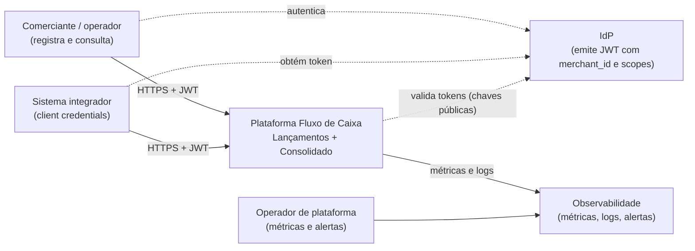
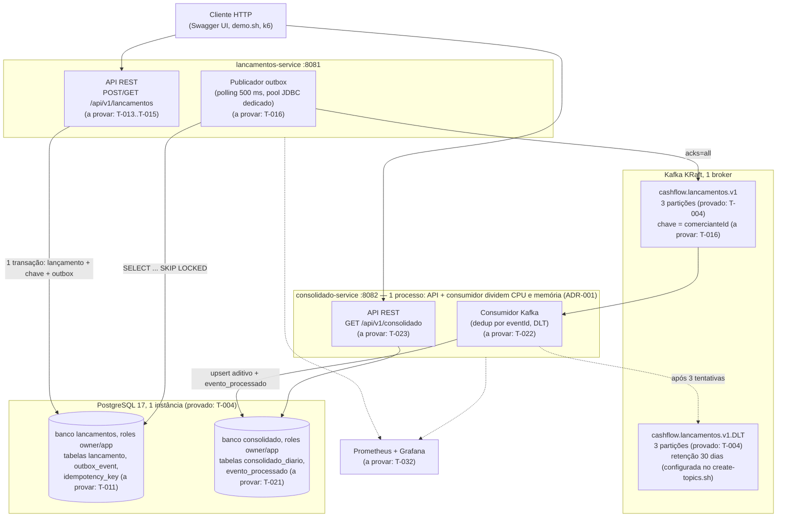
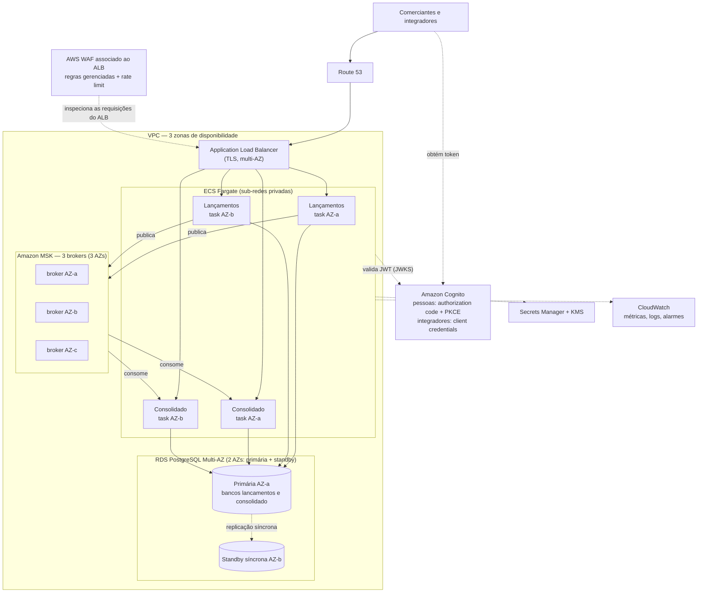

# Arquitetura — Fluxo de Caixa

> Documento de arquitetura do case. Esta versão (T-005) cobre os direcionadores, os diagramas C4, a arquitetura-alvo e as decisões (ADRs). A T-040 acrescenta as visões de runtime e deploy com números medidos.

## 1. Visão geral

Um comerciante registra **lançamentos** (créditos e débitos) e consulta o **saldo diário consolidado**. A solução tem dois serviços que se comunicam **apenas por eventos**:

- **Lançamentos** registra os fatos financeiros (imutáveis; correção é estorno) e publica `LancamentoRegistrado.v1`.
- **Consolidado** consome esses eventos, mantém o movimento diário por comerciante e responde as consultas de saldo.

### 1.1 Direcionadores

| Requisito do enunciado | Como a arquitetura responde | Princípio |
|---|---|---|
| Serviço de lançamentos e serviço de consolidado | Dois executáveis independentes, um banco lógico cada (ADR-001, ADR-002) | P2 |
| Lançamentos não pode cair se o Consolidado cair | Nenhuma chamada síncrona entre serviços; outbox transacional + Kafka (ADR-003). Limites da garantia em §1.3 | P6 |
| 50 req/s no Consolidado em pico, "no máximo 5 % de perda de requisições" | Leitura por chave em projeção pré-agregada; serviços *stateless* escaláveis; a provar com k6 (RNF-002, T-033). "Perda" aqui é **taxa de requisições HTTP com falha** (erro ≥ 500, erro de conexão ou resposta > 2 s, RNF-002) — não perda de lançamentos ou eventos, que é zero por desenho (RNF-004) | P8 |
| Dinheiro e saldo corretos | `BigDecimal`/`NUMERIC`; fatos imutáveis; idempotência fim a fim (ADR-003, ADR-005) | P3, P4, P5 |
| Segurança | JWT, *scopes*, isolamento por comerciante, critérios de integração (ADR-007) | — |
| Documentação e decisões | ADR-001..010, specs em `docs/specs/` | P7, P9 |

### 1.2 Case local × arquitetura-alvo

| | **Case local** (implementado e provado aos poucos, tarefa a tarefa) | **Arquitetura-alvo AWS** (apenas desenho) |
|---|---|---|
| O que é | Código, testes, `docker compose` com PostgreSQL e Kafka, k6, `scripts/demo.sh` | Diagrama e decisões para produção (§6, ADR-010) |
| Evidência | Hoje: `./mvnw verify` (gates da T-002) e `deploy/verify-local.sh` (T-004). Depois: testes de integração e E2E, resultados do k6 em `docs/performance/` (T-033), `demo.sh` (T-035) | Justificativa e trade-offs; números rotulados como **meta** |
| Nuvem | Nenhuma: não há conta AWS, IaC nem deploy | ECS, RDS, MSK, Cognito, CloudWatch — só no desenho |

Este documento usa três estados, e nada é afirmado além do estado indicado:

| Estado | Significado | Exemplos hoje |
|---|---|---|
| **Provado** | Existe no repositório e há verificação executada | Gates de qualidade e regras ArchUnit (T-002); bancos, roles por `CONNECT`, tópico e DLT (T-004) |
| **A provar (T-xxx)** | Faz parte do case local; será implementado e provado na tarefa indicada | APIs, publicador, consumidor, JWT, métricas, carga de 50 req/s |
| **Só desenho** | Existe apenas na arquitetura-alvo; não será provado no case | Multi-AZ, *failover*, RPO/RTO, WAF, Cognito, CloudWatch |

**Regra para mudar um item para "provado":** só com evidência reproduzível registrada — o comando ou teste que prova (`classe#método`, script, cenário k6) e o arquivo de evidência da tarefa (`docs/specs/reviews/T-xxx.evidence.md`) com a revisão independente. Testes de risco contam como prova só na forma exigida (por exemplo, idempotência **concorrente**, não apenas sequencial — `04 §2.7`); carga conta só com resultado medido e versionado (`docs/performance/results/`). Ao concluir cada tarefa, esta tabela e as de §7 e §8 são atualizadas.

As metas da arquitetura-alvo (§6) **nunca** viram "provado" por causa do case local: k6 local mede o código no ambiente local, não o comportamento de ECS, RDS e MSK.

### 1.3 Limites da garantia de disponibilidade (RNF-001)

O desacoplamento assíncrono impede que a queda do **processo** do Consolidado, ou do seu consumidor, interrompa o registro de lançamentos. A garantia **depende** da disponibilidade do banco de Lançamentos e da capacidade de gravar na outbox. O que ela cobre e o que não cobre:

| Falha | Efeito em Lançamentos | Observação |
|---|---|---|
| Processo do Consolidado (API ou consumidor) parado | Segue registrando (201) | Eventos acumulam no Kafka; o consolidado converge quando volta |
| Kafka indisponível | Segue registrando (201) | A outbox cresce; o publicador falha rápido com pool próprio e não bloqueia o HTTP (`03 §7.1`) |
| Indisponibilidade prolongada do Kafka | Segue registrando, com risco crescente | A outbox não tem limite de tamanho: uma falha longa pode saturar o banco. Mitigação: alerta por idade da outbox (ADR-008) e ação operacional |
| Instância PostgreSQL compartilhada indisponível ou saturada | **Para** (os dois serviços) | Dependência compartilhada assumida (D-15, ADR-002); no alvo, mitigada por RDS Multi-AZ, não eliminada |

Separar fisicamente todos os recursos não é necessário para o enunciado; o que importa é declarar o limite da garantia e monitorá-lo.

## 2. Domínios e capacidades

Detalhe em [`01-domain-capabilities.md`](../specs/01-domain-capabilities.md).

| Contexto | Tipo | Capacidades |
|---|---|---|
| **Lançamentos** | Core | Registrar crédito/débito (inclusive retroativo até 30 dias), estornar, consultar histórico, garantir idempotência, publicar fatos |
| **Consolidado** | Core (suporte à decisão) | Aplicar fatos ao movimento diário, consultar o dia e o intervalo, calcular saldo acumulado, medir o frescor da projeção |
| Identidade e acesso | Genérico | IdP externo emite JWT com `merchant_id` e *scopes* |
| Mensageria, observabilidade | Genérico | Plataforma |

Relação entre contextos: Lançamentos publica uma *Published Language* (evento versionado com JSON Schema); o Consolidado é *Conformist* a esse contrato. Não há código compartilhado entre os serviços.

## 3. Contexto (C4 nível 1)

## 4. Contêineres do case local (C4 nível 2)

**Estado atual do case:** o diagrama mostra o case local completo, mas hoje só a infraestrutura está **provada**: PostgreSQL com bancos e roles isolados por `CONNECT`, Kafka com tópico e DLT, verificados por `deploy/verify-local.sh` (T-004). Os serviços ainda têm apenas a classe de inicialização; cada elemento marcado "a provar" entra na tarefa indicada, na ordem do backlog (`docs/specs/06-tasks.md`).

## 5. Fluxos principais

Os diagramas de sequência do registro e do consumo estão em [`03-design-contracts.md §2`](../specs/03-design-contracts.md). O cenário que motiva a arquitetura — **Consolidado fora do ar** — fica assim:

Com o **Kafka** fora, o comportamento é o mesmo do ponto de vista do cliente: o `POST` segue 201 e quem acumula é a **outbox**, que drena quando o broker volta (`03 §7`). Os dois cenários são o comportamento **projetado**; a prova é o teste E2E da T-031 e a demo da T-035. Os limites dessa garantia estão em §1.3.

### 5.1 Estorno no fluxo de eventos

O estorno não edita nem apaga o lançamento original: é um **novo lançamento** do tipo `ESTORNO`, com `id` e `eventId` próprios, `referenciaLancamentoId` apontando o original e `tipoOriginal` (`03 §4`). Ele percorre o mesmo caminho — mesma transação com a outbox, mesmo tópico, mesmo consumidor — e produz efeito **na data do estorno** (ADR-005).

Exemplo: crédito de R$ 100,00 em 15/10, estornado em 22/10.

| Evento | `eventId` | Efeito na projeção | `saldoDia` |
|---|---|---|---|
| `CREDITO` 100.00 (15/10) | E1 | 15/10: `total_creditos += 100.00` | 15/10: +100.00 |
| `ESTORNO` de crédito 100.00 (22/10) | E2 | 22/10: `total_estornos_credito += 100.00` | 22/10: −100.00 |

O crédito continua no histórico de 15/10; o saldo acumulado a partir de 22/10 volta ao valor anterior ao crédito. A deduplicação é por `eventId`: reentregas de E2 são ignoradas, mas E2 **não** é descartado por referenciar um lançamento que já foi processado (E1). O estorno único por lançamento é garantido em Lançamentos, por índice único (AC-003.5), não no consumidor.

## 6. Arquitetura-alvo AWS (apenas desenho)

> Nada desta seção é provisionado. É o desenho de produção pedido no enunciado; decisões e alternativas em [ADR-010](decisions/ADR-010-plataforma-alvo-aws.md). Números são **metas a validar** (RNF-011), não garantias dadas pela escolha dos serviços. O diagrama é de alto nível: sub-redes, *security groups* e rotas estão na tabela e no ADR-010, não no desenho.

| Componente | Responsabilidade | RNF atendido | Meta |
|---|---|---|---|
| Route 53 + ACM | DNS da API e certificados TLS da borda | RNF-005, RNF-011 | — |
| WAF + ALB | TLS, filtragem, *rate limit* por cliente, distribuição entre AZs | RNF-005, RNF-010 | — |
| VPC (sub-redes públicas para o ALB, privadas para ECS/RDS/MSK, *security groups* por serviço) | Isolamento de rede; só o ALB é exposto | RNF-005, RNF-011 | — |
| ECS Fargate (≥ 2 *tasks* por serviço em 2+ AZs, *auto scaling*) | Executar os serviços *stateless* e escalar horizontalmente | RNF-001, RNF-002, RNF-010, RNF-011 | Lançamentos 99,9 %/mês; Consolidado 99,5 %/mês |
| RDS PostgreSQL Multi-AZ (primária + standby em 2 AZs) + PITR | Fonte de verdade e projeção; *failover* automático entre AZs; PITR para corrupção ou erro lógico | RNF-004, RNF-011 | RPO 5 min e RTO 30 min, por cenário no ADR-010 |
| MSK (3 brokers em 3 AZs, RF 3, `min.insync` 2) | Transporte durável de eventos, acúmulo durante falhas; tolera a perda de um broker | RNF-001, RNF-003, RNF-007, RNF-011 | Por cenário no ADR-010 |
| Cognito | Identidade de pessoas (*authorization code* + PKCE) e de integradores (*client credentials*), com `merchant_id` no token (ADR-007) | RNF-005 | — |
| Secrets Manager + KMS | Credenciais e criptografia em repouso | RNF-005 | — |
| CloudWatch | Métricas, logs e alarmes (ADR-008) | RNF-006 | — |

## 7. Do case local ao alvo

Estados conforme §1.2: **provado**, **a provar (T-xxx)** e **só desenho**.

| Peça do case local | Representa no alvo | Estado no case local |
|---|---|---|
| Serviços (`lancamentos-service`, `consolidado-service`) | ECS Fargate com ≥ 2 *tasks* por serviço | Comportamento da aplicação: **a provar** (T-010..T-023, E2E na T-031). Multi-AZ e *auto scaling*: **só desenho** |
| PostgreSQL 17 no compose, 2 bancos e 4 roles | RDS PostgreSQL Multi-AZ com a mesma topologia | Bancos e isolamento de `CONNECT` entre roles: **provado** (T-004). Imutabilidade por *grants* em `lancamento`: **a provar** (T-011). *Failover*, PITR, RPO/RTO: **só desenho** |
| Kafka KRaft com 1 broker | MSK com 3 brokers em 3 AZs | Tópico e DLT com 3 partições: **provado** (T-004). Publicação, acúmulo, consumo e reprocessamento: **a provar** (T-016, T-022, T-031). Replicação entre AZs: **só desenho** |
| Chave de dev + `scripts/DevToken.java` | Cognito | Validação de JWT, *scopes* e isolamento por comerciante: **a provar** (T-013, T-015, T-023). IdP gerenciado: **só desenho** |
| Sem borda | Route 53 + ALB + WAF com *rate limit* | **Só desenho** |
| `.env` local (fora do Git) | Secrets Manager + KMS | Senhas fora do repositório: **provado** (T-004, compose falha sem as variáveis). Gestão de segredos e KMS: **só desenho** |
| Prometheus + Grafana | CloudWatch | Métricas e alertas: **a provar** (T-032). CloudWatch: **só desenho** |
| k6 local | Carga contra o ambiente real | Carga de 50 req/s: **a provar** (T-033); mede o código, não a infraestrutura-alvo |

## 8. Requisitos não funcionais: mecanismo e verificação

| RNF | Mecanismo | Como será verificado | Estado hoje |
|---|---|---|---|
| RNF-001 Isolamento de falha | Nenhuma chamada síncrona; outbox + Kafka; eventos acumulam no Kafka com o Consolidado parado. Limites em §1.3 | Teste E2E com o Consolidado parado; demo | **A provar** (T-031, T-035) |
| RNF-002 Capacidade do Consolidado (50 req/s, taxa de requisições com falha < 5 %) | Leitura por chave em projeção pré-agregada; pools dimensionados; serviço *stateless* | k6 `load.js` com *thresholds* | **A provar** (T-033) |
| RNF-003 Frescor da projeção (meta p95 ≤ 5 s) | Publicador a cada 500 ms e consumidor contínuo são **configuração inicial**, não prova: o tempo total inclui espera do *polling*, publicação, entrega, lote do consumidor, gravação da projeção e filas acumuladas em pico | Tempo **de ponta a ponta**, da criação do evento (`occurredAt`) até a aplicação na projeção (`consolidado_event_lag_seconds`, não apenas o lag do Kafka), medido sob carga concorrente | **A provar** (T-022, T-033) |
| RNF-004 Integridade e não duplicidade | `Idempotency-Key` + FK diferida; `eventId` + `evento_processado`; índices únicos | Testes de concorrência, idempotência e propriedade | **A provar** (T-011, T-012, T-021) |
| RNF-005 Segurança | JWT validado, *scopes*, comerciante só do token, gates de segurança | Testes 401/403/404 cruzado; CodeQL, Dependency-Check, Trivy | **A provar** (T-013, T-015, T-023, T-034) |
| RNF-006 Observabilidade | Métricas de fluxo, logs JSON com `traceId`, alertas (ADR-008) | Testes de actuator; regras carregando | **A provar** (T-032) |
| RNF-007 Resiliência a falha do broker | Outbox cresce, pool dedicado do publicador, *backoff* | Teste E2E com Kafka fora | **A provar** (T-016, T-031) |
| RNF-008 Qualidade | Gates G1–G3, ArchUnit, cobertura | `./mvnw verify` e CI | G2 (`verify` com formatação, Checkstyle, SpotBugs, ArchUnit, JaCoCo) **provado** (T-002); G1 com formatação provada e gitleaks local pendente; G3 (CodeQL, Dependency-Check, Trivy) **a provar** (T-034); harness **a provar** (T-003) |
| RNF-009 Operabilidade local | Compose + README em ≤ 5 comandos | Seguir o README do zero | Infraestrutura **provada** (T-004); fluxo completo **a provar** (T-043) |
| RNF-010 Escalabilidade | Serviços *stateless*; escala horizontal no alvo | k6 informativo a 100 e 200 req/s | **A provar** (T-033); escala no alvo é **só desenho** |
| RNF-011 Disponibilidade e DR (**metas**) | Multi-AZ, PITR, MSK replicado (§6, ADR-010) | Restauração testada quando houver ambiente | **Só desenho** (T-005) |

## 9. Decisões (ADRs)

| ADR | Decisão |
|---|---|
| [001](decisions/ADR-001-monorepo-e-dois-executaveis.md) | Monorepo e dois executáveis independentes |
| [002](decisions/ADR-002-postgresql-jdbcclient-flyway.md) | PostgreSQL + `JdbcClient` + Flyway; sem cache |
| [003](decisions/ADR-003-outbox-publicador-idempotencia.md) | Outbox transacional, publicador por *polling* e idempotência HTTP |
| [004](decisions/ADR-004-kafka-e-contrato-de-evento.md) | Kafka vs alternativas; contrato JSON + JSON Schema |
| [005](decisions/ADR-005-consistencia-eventual-e-projecao.md) | Consistência eventual e projeção comutativa; estorno compensatório |
| [006](decisions/ADR-006-estrategia-de-rebuild.md) | Estratégia de rebuild da projeção (fora do MVP) |
| [007](decisions/ADR-007-seguranca-e-integracao.md) | Modelo de segurança e critérios de integração |
| [008](decisions/ADR-008-observabilidade.md) | Observabilidade |
| [009](decisions/ADR-009-hexagonal-enxuta-archunit.md) | Hexagonal enxuta + ArchUnit |
| [010](decisions/ADR-010-plataforma-alvo-aws.md) | Plataforma-alvo AWS (desenho, não implementado) |

## 10. Evolução e o que ficou de fora

Fora do escopo do case, com o caminho de evolução registrado (`00 §7`):

| Item | Por que ficou fora | Evolução |
|---|---|---|
| Rebuild administrativo da projeção | Risco alto para o ganho no MVP | Reemitir a partir de `lancamento` (ADR-006) |
| CDC com Debezium | Polling atende a latência do case | Se a latência de publicação pesar (ADR-003) |
| Cache distribuído / réplica de leitura | Sem medição que justifique (A9) | Se o k6 mostrar saturação (ADR-002) |
| Schema Registry | Um produtor e um consumidor | Com mais consumidores (ADR-004) |
| Estorno parcial, multi-moeda | Fora do enunciado | Novas regras de domínio |
| Saldo de abertura / migração de legado | O enunciado não descreve legado | Arquitetura de transição (T-041) |
| Frontend próprio | Decisão do dono do produto | API exercitada por Swagger UI, `demo.sh` e k6 |
| IaC e qualquer recurso de nuvem | O alvo é só desenho | Terraform/CDK quando houver ambiente |
