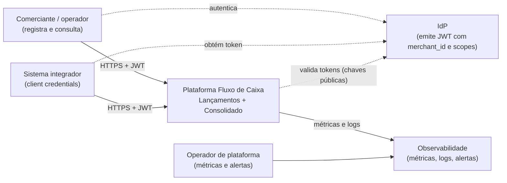
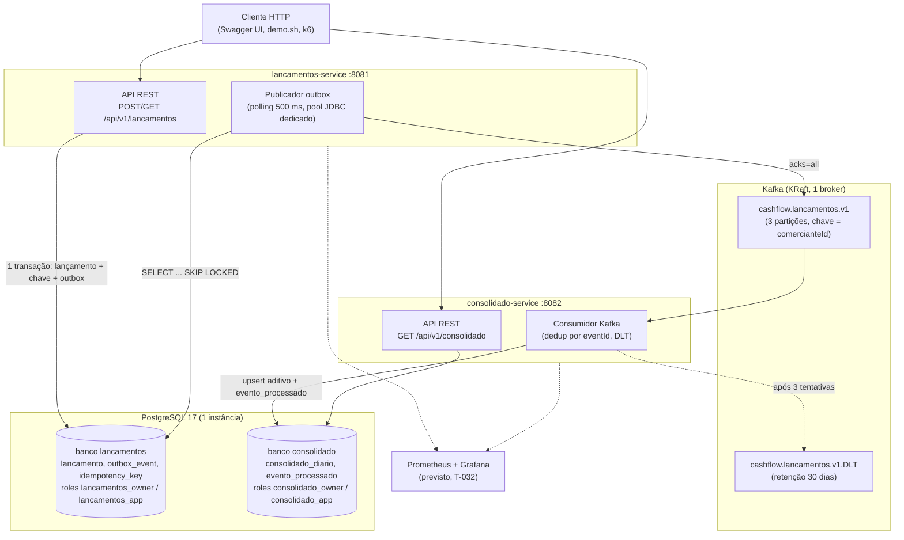
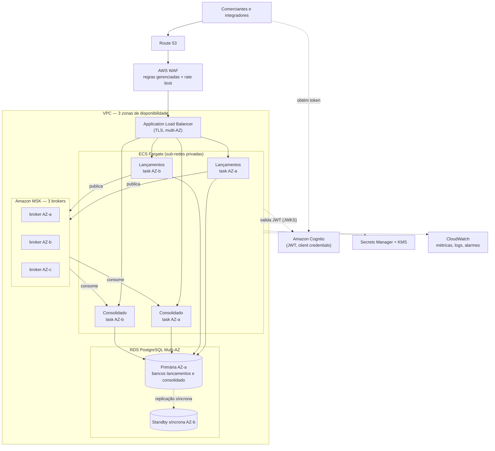

# Arquitetura — Fluxo de Caixa

> Documento de arquitetura do case. Esta versão (T-005) cobre os direcionadores, os diagramas C4, a arquitetura-alvo e as decisões (ADRs). A T-040 acrescenta as visões de runtime e deploy com números medidos.

## 1. Visão geral

Um comerciante registra **lançamentos** (créditos e débitos) e consulta o **saldo diário consolidado**. A solução tem dois serviços que se comunicam **apenas por eventos**:

- **Lançamentos** registra os fatos financeiros (imutáveis; correção é estorno) e publica `LancamentoRegistrado.v1`.
- **Consolidado** consome esses eventos, mantém o movimento diário por comerciante e responde as consultas de saldo.

### 1.1 Direcionadores

| Requisito do enunciado | Como a arquitetura responde | Princípio |
|---|---|---|
| Serviço de lançamentos e serviço de consolidado | Dois executáveis independentes, um banco lógico cada (ADR-001, ADR-002) | P2 |
| Lançamentos não pode cair se o Consolidado cair | Nenhuma chamada síncrona entre serviços; outbox transacional + Kafka (ADR-003) | P6 |
| 50 req/s no Consolidado em pico, perda ≤ 5 % | Leitura por chave em projeção pré-agregada; serviços *stateless* escaláveis; prova com k6 (RNF-002, T-033) | P8 |
| Dinheiro e saldo corretos | `BigDecimal`/`NUMERIC`; fatos imutáveis; idempotência fim a fim (ADR-003, ADR-005) | P3, P4, P5 |
| Segurança | JWT, *scopes*, isolamento por comerciante, critérios de integração (ADR-007) | — |
| Documentação e decisões | ADR-001..010, specs em `docs/specs/` | P7, P9 |

### 1.2 Case local × arquitetura-alvo

| | **Case local** (implementado e provado) | **Arquitetura-alvo AWS** (apenas desenho) |
|---|---|---|
| O que é | Código, testes, `docker compose` com PostgreSQL e Kafka, k6, `scripts/demo.sh` | Diagrama e decisões para produção (§6, ADR-010) |
| Evidência | `./mvnw verify`, `deploy/verify-local.sh`, resultados versionados do k6 | Justificativa e trade-offs; números rotulados como **meta** |
| Nuvem | Nenhuma: não há conta AWS, IaC nem deploy | ECS, RDS, MSK, Cognito, CloudWatch — só no desenho |

Tudo o que este documento afirma como **funcionando** refere-se ao case local. O que é só do alvo está marcado como tal.

## 2. Domínios e capacidades

Detalhe em [`01-domain-capabilities.md`](../specs/01-domain-capabilities.md).

| Contexto | Tipo | Capacidades |
|---|---|---|
| **Lançamentos** | Core | Registrar crédito/débito (inclusive retroativo até 30 dias), estornar, consultar histórico, garantir idempotência, publicar fatos |
| **Consolidado** | Core (suporte à decisão) | Aplicar fatos ao movimento diário, consultar o dia e o intervalo, calcular saldo acumulado, medir o frescor da projeção |
| Identidade e acesso | Genérico | IdP externo emite JWT com `merchant_id` e *scopes* |
| Mensageria, observabilidade | Genérico | Plataforma |

Relação entre contextos: Lançamentos publica uma *Published Language* (evento versionado com JSON Schema); o Consolidado é *Conformist* a esse contrato. Não há código compartilhado entre os serviços.

## 3. Contexto (C4 nível 1)

## 4. Contêineres do case local (C4 nível 2)

**Estado atual do case:** a infraestrutura (PostgreSQL com bancos/roles isolados, Kafka com tópico e DLT) sobe e é verificada por `deploy/verify-local.sh` (T-004). Os serviços estão sendo implementados na ordem do backlog (`docs/specs/06-tasks.md`).

## 5. Fluxos principais

Os diagramas de sequência do registro e do consumo estão em [`03-design-contracts.md §2`](../specs/03-design-contracts.md). O cenário que motiva a arquitetura — **Consolidado fora do ar** — fica assim:

Com o **Kafka** fora, o comportamento é o mesmo do ponto de vista do cliente: o `POST` segue 201 e quem acumula é a **outbox**, que drena quando o broker volta (`03 §7`).

## 6. Arquitetura-alvo AWS (apenas desenho)

> Nada desta seção é provisionado. É o desenho de produção pedido no enunciado; decisões e alternativas em [ADR-010](decisions/ADR-010-plataforma-alvo-aws.md). Números são **metas** (RNF-011).

| Componente | Responsabilidade | RNF atendido | Meta |
|---|---|---|---|
| WAF + ALB | TLS, filtragem, *rate limit* por cliente, distribuição entre AZs | RNF-005, RNF-010 | — |
| ECS Fargate (≥ 2 *tasks* por serviço em 2+ AZs, *auto scaling*) | Executar os serviços *stateless* e escalar horizontalmente | RNF-001, RNF-002, RNF-010, RNF-011 | Lançamentos 99,9 %/mês; Consolidado 99,5 %/mês |
| RDS PostgreSQL Multi-AZ + PITR | Fonte de verdade e projeção; *failover* automático | RNF-004, RNF-011 | RPO 5 min; RTO 30 min |
| MSK (3 AZs, RF 3, `min.insync` 2) | Transporte durável de eventos, acúmulo durante falhas | RNF-001, RNF-003, RNF-007, RNF-011 | RPO 5 min |
| Cognito | Identidade de usuários e integradores | RNF-005 | — |
| Secrets Manager + KMS | Credenciais e criptografia em repouso | RNF-005 | — |
| CloudWatch | Métricas, logs e alarmes (ADR-008) | RNF-006 | — |

## 7. Do case local ao alvo

| Peça do case local | Representa no alvo | Provado localmente? |
|---|---|---|
| Processos/contêineres dos serviços | ECS Fargate com ≥ 2 *tasks* por serviço | Comportamento da aplicação: sim. Multi-AZ e *auto scaling*: **não** |
| PostgreSQL 17 no compose, 2 bancos e 4 roles | RDS PostgreSQL Multi-AZ com a mesma topologia | Isolamento por roles: **sim** (T-004). *Failover*, PITR, RPO/RTO: **não** |
| Kafka KRaft com 1 broker | MSK com 3 brokers em 3 AZs | Tópico, DLT, acúmulo e replay: sim (T-016, T-022, T-031). Replicação entre AZs: **não** |
| Chave de dev + `DevToken.java` | Cognito | Validação de JWT, *scopes* e isolamento: sim (T-013). IdP gerenciado: **não** |
| Sem borda | ALB + WAF com *rate limit* | **Não** |
| `.env` local | Secrets Manager + KMS | **Não** |
| Prometheus + Grafana (T-032) | CloudWatch | Métricas e alertas: sim. CloudWatch: **não** |
| k6 local (T-033) | Carga contra o ambiente real | Mede o código, não a infraestrutura-alvo |

## 8. Requisitos não funcionais: mecanismo e verificação

| RNF | Mecanismo | Como é verificado | Tarefa |
|---|---|---|---|
| RNF-001 Isolamento de falha | Nenhuma chamada síncrona; outbox + Kafka; eventos acumulam no Kafka com o Consolidado parado | Teste E2E com o Consolidado parado; demo | T-031, T-035 |
| RNF-002 Capacidade do Consolidado (50 req/s, falha < 5 %) | Leitura por chave em projeção pré-agregada; pools dimensionados; serviço *stateless* | k6 `load.js` com *thresholds* | T-033 |
| RNF-003 Frescor da projeção (meta p95 ≤ 5 s) | Publicador a cada 500 ms; consumidor contínuo | Métrica `consolidado_event_lag_seconds` durante a carga | T-022, T-033 |
| RNF-004 Integridade e não duplicidade | `Idempotency-Key` + FK diferida; `eventId` + `evento_processado`; índices únicos | Testes de concorrência, idempotência e propriedade | T-011, T-012, T-021 |
| RNF-005 Segurança | JWT validado, *scopes*, comerciante só do token, gates de segurança | Testes 401/403/404 cruzado; CodeQL, Dependency-Check, Trivy | T-013, T-015, T-023, T-034 |
| RNF-006 Observabilidade | Métricas de fluxo, logs JSON com `traceId`, alertas (ADR-008) | Testes de actuator; regras carregando | T-032 |
| RNF-007 Resiliência a falha do broker | Outbox cresce, pool dedicado do publicador, *backoff* | Teste E2E com Kafka fora | T-016, T-031 |
| RNF-008 Qualidade | Gates G1–G3, ArchUnit, cobertura | `./mvnw verify` e CI | T-002 (**provado**), T-003 |
| RNF-009 Operabilidade local | Compose + README em ≤ 5 comandos | Seguir o README do zero | T-004 (**infra provada**), T-043 |
| RNF-010 Escalabilidade | Serviços *stateless*; escala horizontal no alvo | k6 informativo a 100 e 200 req/s | T-033 |
| RNF-011 Disponibilidade e DR (**metas**) | Multi-AZ, PITR, MSK replicado (§6, ADR-010) | Só desenho; restauração testada quando houver ambiente | T-005 (desenho) |

## 9. Decisões (ADRs)

| ADR | Decisão |
|---|---|
| [001](decisions/ADR-001-monorepo-e-dois-executaveis.md) | Monorepo e dois executáveis independentes |
| [002](decisions/ADR-002-postgresql-jdbcclient-flyway.md) | PostgreSQL + `JdbcClient` + Flyway; sem cache |
| [003](decisions/ADR-003-outbox-publicador-idempotencia.md) | Outbox transacional, publicador por *polling* e idempotência HTTP |
| [004](decisions/ADR-004-kafka-e-contrato-de-evento.md) | Kafka vs alternativas; contrato JSON + JSON Schema |
| [005](decisions/ADR-005-consistencia-eventual-e-projecao.md) | Consistência eventual e projeção comutativa; estorno compensatório |
| [006](decisions/ADR-006-estrategia-de-rebuild.md) | Estratégia de rebuild da projeção (fora do MVP) |
| [007](decisions/ADR-007-seguranca-e-integracao.md) | Modelo de segurança e critérios de integração |
| [008](decisions/ADR-008-observabilidade.md) | Observabilidade |
| [009](decisions/ADR-009-hexagonal-enxuta-archunit.md) | Hexagonal enxuta + ArchUnit |
| [010](decisions/ADR-010-plataforma-alvo-aws.md) | Plataforma-alvo AWS (desenho, não implementado) |

## 10. Evolução e o que ficou de fora

Fora do escopo do case, com o caminho de evolução registrado (`00 §7`):

| Item | Por que ficou fora | Evolução |
|---|---|---|
| Rebuild administrativo da projeção | Risco alto para o ganho no MVP | Reemitir a partir de `lancamento` (ADR-006) |
| CDC com Debezium | Polling atende a latência do case | Se a latência de publicação pesar (ADR-003) |
| Cache distribuído / réplica de leitura | Sem medição que justifique (A9) | Se o k6 mostrar saturação (ADR-002) |
| Schema Registry | Um produtor e um consumidor | Com mais consumidores (ADR-004) |
| Estorno parcial, multi-moeda | Fora do enunciado | Novas regras de domínio |
| Saldo de abertura / migração de legado | O enunciado não descreve legado | Arquitetura de transição (T-041) |
| Frontend próprio | Decisão do dono do produto | API exercitada por Swagger UI, `demo.sh` e k6 |
| IaC e qualquer recurso de nuvem | O alvo é só desenho | Terraform/CDK quando houver ambiente |
