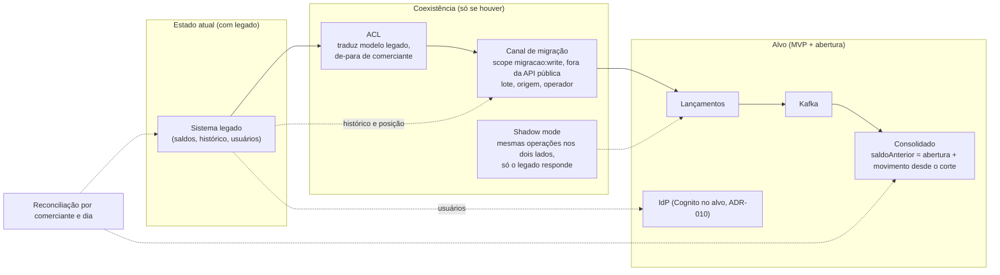

# Arquitetura de transição (condicional)

> **Só desenho.** Nada deste documento está implementado, e nada nele altera o MVP. As decisões, com alternativas, estão no [ADR-011](decisions/ADR-011-arquitetura-de-transicao.md), `Proposto — condicional, não implementado`. Os nomes (`SaldoAberturaRegistrado.v1`, `migracao:write`, tabelas de apoio) são **propostas de desenho**. Nenhum prazo, volume ou custo aparece aqui porque não há legado para medir (P8).

## 1. Premissas e cenários

O enunciado trata a transição como **diferencial condicional** ("se necessária, considerando uma migração de legado") e não descreve nenhum sistema anterior. Por isso:

| Cenário | O que vale | Estado |
|---|---|---|
| **Principal (sem legado)** | Sistema novo; A3 (saldo inicial zero), A5 e A6 valem; nenhuma dependência de legado para funcionar | Implementado e provado (`architecture.md`) |
| **Alternativo (com legado)** | A3 deixa de valer; entram o canal de migração, o saldo de abertura, a reconciliação e a migração de identidade | Só desenho (este documento) |

Regra que atravessa tudo: **a API pública nunca cria crédito ou débito fictício para representar saldo.** Um `CREDITO` inventado para "carregar" o saldo falsificaria o fato financeiro, o extrato e os totais do dia (P4).

## 2. Dados financeiros

### 2.1 Canal de migração
Separado da API pública, com *scope* próprio (`migracao:write`, proposta), **auditável** (origem, lote, operador, instante) e **idempotente**: `identificadorExterno` já é único por comerciante no MVP (`ux_identificador_externo`), e o lote acrescenta a chave de repetição segura da carga. A4 (retroatividade de 30 dias) é regra da API pública; a carga histórica passa pelo canal e entra no Kafka como o mesmo `LancamentoRegistrado.v1`, com `dataReferencia` histórica. A projeção aceita (é aditiva e comutativa, ADR-005); o que muda é o volume, que pede ritmo controlado para não encher a outbox.

### 2.2 Posição inicial: histórico × saldo de abertura
| | Importar o histórico como lançamentos | Registrar um saldo de abertura (data de corte) |
|---|---|---|
| Quando | **Preferida** quando o histórico existe e é confiável | Só existe a posição, ou o histórico é inviável ou não confiável |
| Ganho | Extrato completo, saldo por dia correto, auditoria por lançamento | Simples, rápido e barato; uma linha por comerciante |
| Custo | Volume, qualidade dos dados, estornos e retroativos do legado | Sem extrato antes do corte; a abertura é um número que se confia |
| Efeito no desenho | Nenhum contrato novo | Fato novo e novo cálculo do `saldoAnterior` (abaixo) |

### 2.3 Saldo de abertura: o desenho recomendado (Q-088)
- **Fato próprio, evento novo `SaldoAberturaRegistrado.v1`**, com `eventId`, `comercianteId`, `dataCorte`, `valor` (decimal em *string*, pode ser negativo, A6) e `origem`/`lote` de auditoria. Não é `CREDITO` nem `DEBITO` e não tem `lancamentoId`.
- **O `LancamentoRegistrado.v1` não muda.** A regra de evolução do contrato (`03 §4`) só admite campos opcionais, e um saldo de abertura não cabe nele: `tipo` é um enumerado fechado (um valor novo é incompatível para consumidores antigos), e campos "de carona" criariam obrigatoriedade condicional (como o `ESTORNO` já tem) para um fato que não é um lançamento.
- **Projeção:** guarda a abertura por comerciante e data de corte, idempotente por `eventId` (mesma tabela de deduplicação). **Leitura:** `saldoAnterior = abertura + Σ saldoDia onde corte ≤ data < dataInicio`. Os dias anteriores ao corte não são cobertos.
- **Comutatividade preservada (ADR-005):** a abertura é **um termo aditivo** da soma, aplicado uma vez; a ordem de chegada entre a abertura e os lançamentos é irrelevante, porque a soma só é calculada na leitura. Correção antes do *go-live*: novo evento de ajuste aditivo (valor pode ser negativo), não substituição.
- **Lançamento da API pública com `dataReferencia` anterior ao corte** é rejeitado (422) para o comerciante migrado: o efeito dele já está dentro da abertura.

**Exemplo ilustrativo (não é medição):** abertura de R$ 10.000,00 com corte em 01/11. Dia 01/11: créditos de R$ 500,00 e débitos de R$ 200,00, `saldoDia` = +300,00. Dia 02/11: débito de R$ 1.000,00, `saldoDia` = −1.000,00. Consulta de 02/11 a 03/11 (03/11 sem movimento): `saldoAnterior` = 10.000,00 + 300,00 = **10.300,00**; `saldoAcumulado` de 02/11 = 10.300,00 − 1.000,00 = **9.300,00**; o de 03/11 = **9.300,00**. Em qualquer ordem de chegada dos eventos, o resultado é o mesmo.

### 2.4 Estornos parciais ou múltiplos do legado
A5 (estorno total e único) vale para a API pública. **Critério:** nunca distorcer o saldo e nunca inventar registro. **Regra padrão proposta:** importar cada estorno do legado como um **lançamento compensatório simples** (crédito ou débito) com referência externa, **sem** o vínculo `ESTORNO`, que exigiria o original, o valor total e a unicidade. A regra final depende da análise do legado real e então vira ADR.

### 2.5 Reconciliação e corte
- **Reconciliação por comerciante e dia:** posição final do dia no legado × `saldoAcumulado` do Consolidado no mesmo dia, em relatório de divergências antes do *go-live*.
- **Critério de aceite do corte:** divergência **zero ou explicada** (cada diferença com causa classificada: instante do corte, lançamento só em um lado, arredondamento, estorno). O número de dias consecutivos que sustenta o aceite é decisão do negócio, não deste documento.
- **Rollback:** enquanto não houver aceite, o legado segue como fonte de verdade; o canal idempotente permite repetir a carga, e o *shadow mode* (quando há coexistência) mostra a divergência antes da troca.

## 3. Identidade
Usuários e comerciantes migram para o **IdP** (nunca para um cadastro próprio da aplicação, ADR-007); o `merchant_id` do token passa a ser o UUID novo.

| Estratégia | Quando usar | Observação |
|---|---|---|
| Importação em lote com hash compatível | O IdP aceita o formato do hash legado e o hash é forte | Depende do IdP: no Cognito não se assume importar senha (a validar no provedor); o Keycloak aceita hashes importados (ambos a validar no provedor) |
| Migração preguiçosa no primeiro login (no Cognito, *user migration trigger*) | Há coexistência ou o hash não pode ser lido em lote; o usuário autentica no legado uma vez | Mantém o legado de pé até a base ativa migrar; usuários inativos ficam de fora |
| Federação com o IdP legado durante a coexistência | O legado já expõe OIDC ou SAML e a troca de IdP precisa ser gradual | Aumenta a superfície; tem prazo para acabar |
| Redefinição obrigatória de senha | Hash fraco ou ilegível, ou incidente | Pior experiência; é a opção segura de último caso |

- **De-para de comerciante** (código legado → UUID) vive na **ACL**, em tabela própria, nunca no domínio; é a fonte do `comercianteId` usado na carga e no `merchant_id`.
- **Integradores legados:** novas credenciais *client credentials* por integrador (um *app client* cada, ADR-010), com período de convivência em que os dois mecanismos valem, e depois o legado é desligado.

## 4. ACL e coexistência
A **camada anticorrupção** traduz o modelo legado para os contratos de Lançamentos e fica fora do domínio (ADR-009). **Strangler Fig** e **shadow mode** entram **só se houver coexistência**: o shadow repete as operações nos dois sistemas e responde com o legado, até a reconciliação estar dentro do critério da §2.5.

## 5. O que o MVP já comporta
`identificador_externo` único por comerciante, `saldoAnterior` calculado na leitura (aceita uma base de abertura sem recálculo em cascata) e eventos versionados (um fato novo é um evento novo). O que **não** existe e teria de ser construído: o canal de migração e seu *scope*, o evento e a tabela de abertura, o de-para, o relatório de reconciliação e a migração de usuários.
