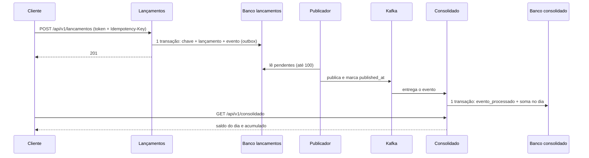

# Como funciona: o caminho de um lançamento

> Guia de conceito, para entender por dentro sem ler o código. Os termos técnicos estão no [glossário](glossario.md). Para rodar, veja o [README](../../README.md#veja-funcionando-em-5-etapas).

## Em uma frase

Um lançamento é gravado no serviço de Lançamentos junto com um "bilhete" (o evento); um publicador leva o bilhete ao Kafka; o serviço de Consolidado lê o bilhete e soma o valor no dia certo.

## Uma analogia

Uma loja. Você anota a venda no caderno do caixa (o **lançamento**) e, **na mesma caneta e na mesma hora**, deixa um bilhete na caixa de saída (a **outbox**). Um entregador (o **publicador**) leva os bilhetes pelo correio (o **Kafka**) até a contabilidade (o **Consolidado**), que soma tudo no livro do dia. Se a contabilidade fechar para o almoço, os bilhetes esperam no correio e o caixa continua vendendo. Se o entregador entregar o mesmo bilhete duas vezes, a contabilidade percebe pelo número do bilhete e soma só uma vez.

## O passo a passo, com um exemplo

Um comerciante registra três lançamentos no mesmo dia: crédito de 1000,00, débito de 250,00 e crédito de 80,00. Depois estorna o débito e registra um crédito retroativo de 500,00, de três dias atrás. São os mesmos valores que o `scripts/demo.sh` confere.

| # | O que acontece | Quem faz | Onde fica o resultado |
|---|---|---|---|
| 1 | O cliente envia `POST /api/v1/lancamentos` com um token (JWT), o cabeçalho `Idempotency-Key` e o corpo (tipo, valor) | Cliente para o Lançamentos (porta 8081) | Nada ainda |
| 2 | O serviço confere o token e o escopo, valida os campos e gera o `id` do lançamento | Lançamentos | Memória |
| 3 | **Numa única transação**, grava a chave de idempotência, o lançamento e o evento na outbox. Se algo falhar, nada fica gravado | Lançamentos | Banco `lancamentos`: `idempotency_key`, `lancamento`, `outbox_event` |
| 4 | Responde `201` ao cliente | Lançamentos | — |
| 5 | O publicador lê os eventos pendentes da outbox (até 100 por vez), envia ao Kafka e marca cada um como publicado | Publicador, dentro do Lançamentos | Tópico `cashflow.lancamentos.v1`; coluna `published_at` |
| 6 | O consumidor lê o evento, confere o formato, ignora se já viu aquele `eventId` e, senão, soma no dia do lançamento, tudo numa transação | Consolidado | Banco `consolidado`: `evento_processado`, `consolidado_diario` |
| 7 | O cliente consulta `GET /api/v1/consolidado` e recebe, por dia: totais, saldo do dia e saldo acumulado | API do Consolidado | — |

**Os números do exemplo:**
- Depois dos três lançamentos, o saldo do dia é 1000,00 + 80,00 − 250,00 = **830,00**.
- O estorno do débito de 250,00 é **um novo lançamento** (do tipo `ESTORNO`, no dia de hoje); nada é apagado. O saldo do dia passa a **1080,00**.
- O crédito retroativo de 500,00 soma no dia dele (três dias atrás): saldo daquele dia **500,00**. O saldo acumulado de hoje é 500,00 + 1080,00 = **1580,00**.



## Quando algo falha

| Falha | O que acontece | Onde está provado |
|---|---|---|
| Consolidado parado | O `POST` segue devolvendo `201`. Os eventos esperam no Kafka e, quando o Consolidado volta, ele os lê e converge | `ConsolidadoParadoIT`; passo do Consolidado parado da demo |
| Kafka fora | O `POST` segue `201`. A outbox cresce; o publicador espera cada vez mais entre as tentativas (1 s, 2 s, 4 s... até 30 s) e drena quando o Kafka volta | `KafkaForaIT`; `demo.sh --kafka-down` |
| Evento repetido | O consumidor reconhece o `eventId` e não soma de novo | `DeduplicacaoConcorrenteIT` |
| Evento inválido ou falha repetida | Vai para a fila de falhas (DLT): direto, se o formato estiver fora do contrato; depois de 1 + 3 tentativas, nos demais casos | `DltIT` |
| Banco de Lançamentos fora | O Lançamentos para (a dependência é assumida e está em [arquitetura §1.3](../architecture/architecture.md)) | — |

## Onde está no código

| Peça | Ponteiro | O que faz |
|---|---|---|
| Entrada do `POST` | `LancamentoController#registrar` | Recebe o pedido, lê o `Idempotency-Key`, devolve `201` e o cabeçalho de repetição |
| Caso de uso do registro | `RegistrarLancamento#registrar` | Valida, abre a transação e grava lançamento e evento |
| Idempotência | `ExecucaoIdempotente#executar` | Garante um único lançamento por chave |
| Gravação da outbox | `OutboxJdbcRepository` | Insere o evento na mesma transação do lançamento e serve o publicador |
| Ciclo do publicador | `PublicarOutbox#publicarLote` | Trava os pendentes, publica e marca como publicados |
| Envio ao Kafka | `PublicadorKafka#publicar` | Envia o lote ao tópico, com a chave do comerciante |
| Leitura do evento | `ConsumidorDeLancamentos#consumir` | Lê um registro por vez, aplica e confirma |
| Aplicação no dia | `AplicarEvento#aplicar` | Soma o efeito do evento, uma vez só |
| SQL da projeção | `ProjecaoJdbcRepository#aplicarSeNovo` | Deduplica e soma, num único comando |
| Consulta | `ConsultarConsolidado#intervalo` | Preenche os dias sem movimento e calcula os saldos |
| Rota da consulta | `ConsolidadoController` | `GET /api/v1/consolidado` e `/{data}` |

## Como ver funcionando

Com a stack no ar (etapas 1 a 4 do [README](../../README.md#veja-funcionando-em-5-etapas)), rode a demonstração. Ela registra, estorna, faz o retroativo, para o Consolidado e confere cada saldo:

**bash (Linux, macOS e Git Bash)**

```bash
scripts/demo.sh
```

**PowerShell (Windows)**

```powershell
& "C:\Program Files\Git\bin\bash.exe" scripts/demo.sh
```

**O que você deve ver:** blocos com `✔` e valores como `saldo do dia (1080 - 250) (= 830.00)`, `saldo do dia após estorno (= 1080.00)` e `saldo acumulado hoje (500 + 1080) (= 1580.00)`, e no fim `Demonstração concluída: RF-007, RF-003, RF-009, RF-010 e RNF-001`.

## O que pode dar errado

- **O saldo não mudou logo depois do `POST`.** É esperado: o evento ainda está a caminho. Em medição local, o atraso foi de menos de 1 segundo (p95 de 0,69 s, [relatório](../performance/relatorio.md)); espere um instante e consulte de novo.
- **O Consolidado não mostra um lançamento.** Confira se o consumidor está rodando e se o evento não foi para a DLT (veja o [runbook](../runbooks/dlt-reprocessamento.md)).

## Ligações

- Decisões: [ADR-003](../architecture/decisions/ADR-003-outbox-publicador-idempotencia.md) (outbox e idempotência), [ADR-005](../architecture/decisions/ADR-005-consistencia-eventual-e-projecao.md) (saldo por soma e consistência eventual) e [ADR-004](../architecture/decisions/ADR-004-kafka-e-contrato-de-evento.md) (contrato do evento).
- Requisitos provados: RNF-001 por `ConsolidadoParadoIT` e RNF-007 por `KafkaForaIT`; a matriz completa está em [`traceability.md`](../specs/traceability.md).
- Aprofunde: [idempotência](idempotencia.md), [outbox e publicador](outbox-e-publicador.md), [consumidor e consolidado](consumidor-e-consolidado.md) e [observabilidade por dentro](observabilidade-por-dentro.md).
