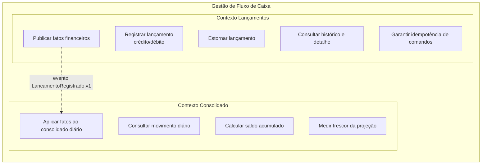

# 01 · Domínios Funcionais e Capacidades de Negócio

## 1. Mapa de domínios

| Domínio / subdomínio | Tipo (DDD) | Contexto delimitado | Responsabilidade |
|---|---|---|---|
| Registro de movimentações financeiras | **Core** | Lançamentos | Registrar créditos/débitos, estornar, manter trilha imutável |
| Consolidação de fluxo de caixa | **Core (suporte à decisão do comerciante)** | Consolidado | Manter movimento diário e saldo acumulado derivados dos fatos |
| Identidade e acesso | Genérico | Externo (IdP) | Autenticar, emitir JWT com `merchant_id` e *scopes* |
| Mensageria | Genérico | Plataforma | Transporte confiável de eventos |
| Observabilidade | Genérico | Plataforma | Métricas, logs, traces, alertas |

## 2. Capacidades de negócio

| Capacidade | Contexto | Requisitos | Observação |
|---|---|---|---|
| Registrar lançamento | Lançamentos | RF-001, RF-002, RF-009 | Inclui retroativo |
| Estornar lançamento | Lançamentos | RF-003 | Total, único, compensatório |
| Consultar histórico/detalhe | Lançamentos | RF-004, RF-010 | Paginado, isolado por comerciante |
| Idempotência de comandos | Lançamentos | RF-007, RNF-004 | `Idempotency-Key` |
| Publicar fatos | Lançamentos | RNF-001, RNF-007 | Outbox transacional |
| Aplicar fatos ao consolidado | Consolidado | RF-008, RNF-003 | Consumo idempotente |
| Consultar movimento diário | Consolidado | RF-005, RNF-002 | 50 req/s em pico |
| Saldo acumulado | Consolidado | RF-006 | Calculado na leitura |
| Medir frescor | Consolidado | RNF-003, RNF-006 | Métrica de *lag* |

## 3. Mapa de contextos (relacionamento)
- **Lançamentos → Consolidado:** *Published Language* (evento versionado com JSON Schema) sobre Kafka. O Consolidado é *Conformist* ao contrato de evento; não há *Shared Kernel* de código.
- **Ambos → IdP:** *Customer/Supplier* via JWT (padrão aberto).

## 4. Atores
- **Comerciante/operador:** registra e estorna lançamentos, consulta o consolidado.
- **Sistema integrador:** consome as APIs com credenciais próprias (*client credentials*) e *scopes* mínimos.
- **Operador de plataforma:** observa métricas/alertas (sem acesso a dados financeiros além do necessário).
