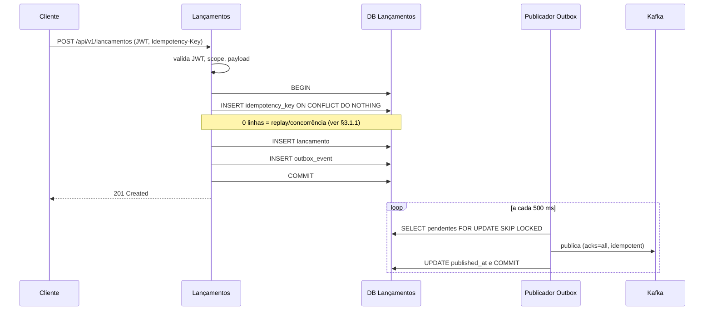
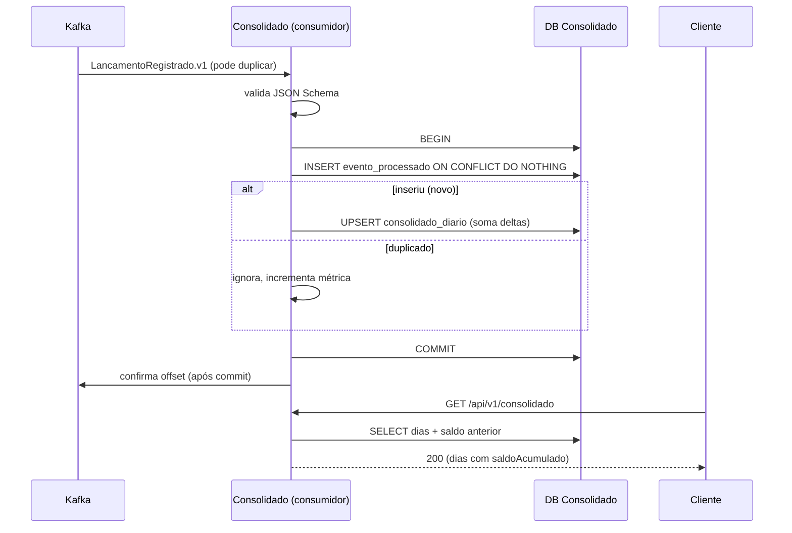

# 03 · Design, Decisões e Contratos

## 1. Decisões e trade-offs
Cada linha vira (ou alimenta) um ADR em `docs/architecture/decisions/`.

| # | Decisão | Escolha | Alternativas rejeitadas | Por quê / custo assumido | Revisitar quando |
|---|---|---|---|---|---|
| D-01 | Estilo | 2 serviços implantáveis (Lançamentos, Consolidado) em monorepo | Monólito modular; microsserviço por entidade | RNF-001 exige domínio de falha separado. Custo: consistência eventual e mais operação. Não fragmentar além disso (P2) | Se o time/volume exigir separar mais |
| D-02 | Integração | Outbox transacional + Kafka | Chamada HTTP síncrona; *dual write*; CDC (Debezium); ETL em lote | Elimina *dual write* e acoplamento de disponibilidade. Custo: tabela outbox, publicador, duplicatas | Latência de publicação virar problema → CDC |
| D-03 | Broker | Kafka (KRaft local) | RabbitMQ; SQS/SNS | Ordenação por chave, retenção e replay combinam com a projeção. Custo: operação mais pesada; MSK tende a dominar o custo em carga baixa | Se replay/ordenação não forem necessários e custo pesar → SQS/SNS |
| D-04 | Banco | PostgreSQL | DynamoDB; MongoDB | Constraints, `NUMERIC`, índices parciais únicos, `SKIP LOCKED`, `ON CONFLICT` sustentam integridade financeira | Escala de escrita que PostgreSQL não atenda |
| D-05 | Acesso a dados | `JdbcClient` + Flyway | JPA/Hibernate | Upsert, `SKIP LOCKED` e SQL explícito pedem controle fino; domínio fica puro. Custo: mais SQL manual | — |
| D-06 | Modelo da projeção | Só **movimento diário aditivo**; saldo acumulado calculado na leitura | Saldo de fechamento materializado | Somas são comutativas: ordem e retroatividade não exigem recálculo em cascata. Custo: leitura soma o histórico | Histórico longo → *snapshots* periódicos |
| D-07 | Estorno | Lançamento compensatório na data do estorno | Reverter na data original | Dias passados nunca são reescritos (prática contábil) | Exigência regulatória diferente |
| D-08 | Idempotência HTTP | Tabela `idempotency_key` na mesma transação: `INSERT ... ON CONFLICT DO NOTHING` + FK **diferida** para o lançamento; a resposta é **reconstruída** do lançamento imutável (não é armazenada) | Redis; guardar `response_body`; só `identificador_externo` | A chave existe antes da resposta, então não há colunas de resposta a preencher; o PK serializa a concorrência e a FK diferida impede commit de chave sem lançamento. Só criações bem-sucedidas são registradas (erro faz rollback e o retry reavalia) | Volume exigir TTL/cleanup dedicado |
| D-09 | Publicador | Polling com `FOR UPDATE SKIP LOCKED` dentro de Lançamentos, com **pool JDBC dedicado**, timeouts explícitos e *backoff* (§7.1) | Debezium; publicar *after-commit* em memória; *claim/lease* com publicação fora da transação | Simples e durável; o pool dedicado impede que falha do Kafka consuma conexões da API. Custo: latência = intervalo de *polling* (500 ms). *Claim/lease* só se a medição mostrar necessidade (ADR-003) | Latência/volume → CDC; contenção observada → *claim/lease* |
| D-10 | Deploy do Consolidado | 1 executável com consumidor + API (toggle `consolidado.consumer.enabled`) | Dois serviços | Menos peças; separável sem mudar código | Carga de consumo afetar a API de leitura |
| D-11 | Autenticação | JWT (Resource Server); dev com chave local, prod com IdP | Login próprio; API keys | Padrão aberto, sem guardar senha | — |
| D-12 | Cache | Nenhum | Redis/Caffeine | 50 req/s em leitura por PK é trivial; decidir com dado do k6 | k6 mostrar saturação |
| D-13 | Contrato de evento | JSON + JSON Schema versionado | Avro + Schema Registry | Menos infraestrutura; validado nos dois lados. Custo: sem registro central | Muitos produtores/consumidores |
| D-14 | Rebuild da projeção | Fora do MVP; estratégia em ADR-006 | Endpoints `/admin/rebuilds` | Kafka tem retenção finita; rebuild real depende da fonte de verdade (tabela `lancamento`). Escopo e risco altos para o ganho | Divergência real ou novo consumidor |
| D-15 | Banco físico | 1 instância, 2 bancos, 2 *roles* (cada serviço só acessa o seu) | Instâncias separadas | Isolamento lógico verificável com custo baixo. Alvo AWS (desenho): mesma topologia em RDS PostgreSQL Multi-AZ, ADR-010 | Requisito de isolamento físico |
| D-16 | Observabilidade | Micrometer/OTel/Prometheus/Grafana local; CloudWatch no alvo | Só logs | Mostra operação real sem exagero | — |

## 2. Fluxos

### 2.1 Registro de lançamento


### 2.2 Consumo e consulta


## 3. Modelo de dados

### 3.1 Banco `lancamentos` (roles: `lancamentos_owner` migra; `lancamentos_app` opera)
```sql
CREATE TABLE lancamento (
  id UUID PRIMARY KEY,
  comerciante_id UUID NOT NULL,
  tipo VARCHAR(10) NOT NULL CHECK (tipo IN ('CREDITO','DEBITO','ESTORNO')),
  valor NUMERIC(15,2) NOT NULL CHECK (valor > 0),
  descricao VARCHAR(255),
  data_ocorrencia TIMESTAMPTZ NOT NULL,
  data_referencia DATE NOT NULL,
  referencia_lancamento_id UUID REFERENCES lancamento(id),
  tipo_original VARCHAR(10) CHECK (tipo_original IN ('CREDITO','DEBITO')),
  identificador_externo VARCHAR(100),
  criado_em TIMESTAMPTZ NOT NULL DEFAULT now(),
  CONSTRAINT ck_estorno CHECK (
    (tipo = 'ESTORNO' AND referencia_lancamento_id IS NOT NULL AND tipo_original IS NOT NULL)
    OR (tipo <> 'ESTORNO' AND referencia_lancamento_id IS NULL AND tipo_original IS NULL))
);
CREATE UNIQUE INDEX ux_estorno_unico ON lancamento (referencia_lancamento_id) WHERE tipo = 'ESTORNO';
CREATE UNIQUE INDEX ux_identificador_externo ON lancamento (comerciante_id, identificador_externo) WHERE identificador_externo IS NOT NULL;
CREATE INDEX ix_lancamento_historico ON lancamento (comerciante_id, data_referencia DESC, id);
-- Imutabilidade: REVOKE UPDATE, DELETE ON lancamento FROM lancamentos_app;

CREATE TABLE outbox_event (
  event_id UUID PRIMARY KEY,
  aggregate_id UUID NOT NULL,
  topic VARCHAR(100) NOT NULL,
  message_key VARCHAR(64) NOT NULL,
  event_type VARCHAR(100) NOT NULL,
  schema_version INTEGER NOT NULL,
  payload JSONB NOT NULL,
  created_at TIMESTAMPTZ NOT NULL DEFAULT now(),
  published_at TIMESTAMPTZ,
  attempt_count INTEGER NOT NULL DEFAULT 0,
  last_error TEXT,
  request_id VARCHAR(64)                   -- X-Request-Id da requisição de origem; vira o cabeçalho Kafka x-request-id (§5.2)
);
CREATE INDEX ix_outbox_pendentes ON outbox_event (created_at) WHERE published_at IS NULL;

CREATE TABLE idempotency_key (
  comerciante_id UUID NOT NULL,
  chave VARCHAR(64) NOT NULL,
  request_hash CHAR(64) NOT NULL,          -- SHA-256 de método + caminho + corpo canônico
  lancamento_id UUID NOT NULL,             -- gerado antes do INSERT; a resposta é reconstruída a partir dele
  criado_em TIMESTAMPTZ NOT NULL DEFAULT now(),
  PRIMARY KEY (comerciante_id, chave),
  CONSTRAINT fk_idem_lancamento FOREIGN KEY (lancamento_id) REFERENCES lancamento (id)
    DEFERRABLE INITIALLY DEFERRED          -- no COMMIT, a chave só existe se o lançamento existir
);
```

### 3.1.1 Algoritmo de idempotência e concorrência
Isolamento `READ COMMITTED`. Para `POST` (lançamento ou estorno):
1. Validar JWT e os **campos** do payload (sem banco; erro → 400). Gerar `lancamentoId` (porta `IdGenerator`) e calcular `request_hash`. As regras que dependem do relógio (data futura, retroatividade; 422) **não** entram aqui: ficam no passo 4, para que um *replay* devolva sempre o original, mesmo depois de a data sair da janela (Q-011).
2. `BEGIN`.
3. `INSERT INTO idempotency_key (...) ON CONFLICT (comerciante_id, chave) DO NOTHING`.
   - **1 linha:** a chave é nossa; seguir.
   - **0 linhas** (o PostgreSQL faz o `INSERT` aguardar o *commit/rollback* de uma transação concorrente com a mesma chave; a transação **não** fica inutilizada, ao contrário de capturar violação de unicidade): `SELECT request_hash, lancamento_id` da chave.
     - Linha ausente (a concorrente deu *rollback*): repetir o passo 3 (até 3 vezes).
     - `request_hash` diferente: `ROLLBACK` e **422**.
     - `request_hash` igual: `ROLLBACK`, ler o lançamento por `lancamento_id` e responder **201** com o mesmo corpo e `Idempotent-Replayed: true`.
4. Aplicar as regras de negócio (inclusive as de data, 422, que desfazem a chave junto), `INSERT` em `lancamento` (com o `lancamentoId` gerado) e em `outbox_event`.
5. `COMMIT`. A FK diferida garante que nenhuma chave é confirmada sem lançamento. Qualquer falha antes do `COMMIT` desfaz chave, lançamento e evento juntos (retry seguro).

Resultado esperado: exatamente 1 lançamento, 1 evento e a mesma resposta em chamadas repetidas ou simultâneas.

### 3.2 Banco `consolidado` (roles: `consolidado_owner` / `consolidado_app`)
```sql
CREATE TABLE consolidado_diario (
  comerciante_id UUID NOT NULL,
  data_referencia DATE NOT NULL,
  total_creditos NUMERIC(18,2) NOT NULL DEFAULT 0,
  total_debitos NUMERIC(18,2) NOT NULL DEFAULT 0,
  total_estornos_credito NUMERIC(18,2) NOT NULL DEFAULT 0,
  total_estornos_debito NUMERIC(18,2) NOT NULL DEFAULT 0,
  qtd_lancamentos INTEGER NOT NULL DEFAULT 0,
  atualizado_em TIMESTAMPTZ NOT NULL,
  PRIMARY KEY (comerciante_id, data_referencia)
);
CREATE TABLE evento_processado (
  event_id UUID PRIMARY KEY,
  processado_em TIMESTAMPTZ NOT NULL DEFAULT now()
);
```
Upsert aditivo atômico (sem ler-modificar-escrever): `INSERT ... ON CONFLICT (comerciante_id, data_referencia) DO UPDATE SET total_x = consolidado_diario.total_x + EXCLUDED.total_x, ...`.

Regra de efeito por evento: `CREDITO` → `total_creditos += valor`; `DEBITO` → `total_debitos += valor`; `ESTORNO` com `tipoOriginal=CREDITO` → `total_estornos_credito += valor`; com `DEBITO` → `total_estornos_debito += valor`. Em todos: `qtd_lancamentos += 1`.

Leitura: `saldoAnterior = Σ saldoDia onde data < dataInicio`; `saldoAcumulado` por dia = `saldoAnterior + soma de janela` sobre o intervalo.

## 4. Contrato do evento `LancamentoRegistrado.v1`
Tópico `cashflow.lancamentos.v1` (chave = `comercianteId`, 3 partições); DLT `cashflow.lancamentos.v1.DLT`. Schema em `contracts/events/lancamento-registrado.v1.schema.json` (`additionalProperties:false`).

```json
{
  "eventId": "uuid",
  "eventType": "LancamentoRegistrado",
  "schemaVersion": 1,
  "occurredAt": "2026-10-21T14:03:11Z",
  "comercianteId": "uuid",
  "lancamentoId": "uuid",
  "tipo": "CREDITO | DEBITO | ESTORNO",
  "valor": "123.45",
  "dataReferencia": "2026-10-21",
  "tipoOriginal": "CREDITO | DEBITO (obrigatório se e somente se ESTORNO)",
  "referenciaLancamentoId": "uuid (obrigatório se e somente se ESTORNO)",
  "traceId": "opcional"
}
```
Regras: o consumidor **nunca recalcula** `dataReferencia` e nunca consulta Lançamentos (`tipoOriginal` existe para isso). Evolução: só campos opcionais em `v1`; mudança incompatível → novo tópico/versão. Sem dados pessoais nem descrição livre no evento.

## 4.1 Regra de datas (fuso de negócio `America/Sao_Paulo`)
1. `dataOcorrencia` é um **instante ISO-8601 com offset ou `Z`**. Sem offset → 400 (ambíguo).
2. Omitida → instante de `Clock`.
3. `dataReferencia = instante.atZone(America/Sao_Paulo).toLocalDate()`. Nunca a data UTC. Calculada **somente** em Lançamentos; o consumidor Kafka nunca a recalcula.
4. Futuro: instante > agora + `lancamentos.max-future-skew` (padrão 60 s) → 422. Retroatividade: `dataReferencia < hoje(SP) − max-backdate-days` → 422 (dia −30 aceito, dia −31 rejeitado).
5. Estorno: `dataReferencia` = data de agora no fuso de negócio, independentemente da data do original.

| Entrada | Instante (UTC) | `dataReferencia` | Observação |
|---|---|---|---|
| `2026-10-21T23:30:00-03:00` | 2026-10-22T02:30Z | 2026-10-21 | a data UTC (22) estaria errada |
| `2026-10-22T02:30:00Z` | 2026-10-22T02:30Z | 2026-10-21 | mesmo instante, outro offset |
| `2026-10-22T02:59:59Z` | — | 2026-10-21 | último segundo do dia 21 em SP |
| `2026-10-22T03:00:00Z` | — | 2026-10-22 | meia-noite em SP: início do dia 22 |
| `2026-10-22T01:30:00+01:00` | 2026-10-22T00:30Z | 2026-10-21 | offset não brasileiro |
| `2026-10-21T23:30:00` (sem offset) | — | **400** | ambíguo |
| omitida, agora = 2026-10-22T01:00Z | — | 2026-10-21 | usa `Clock` (22:00 em SP) |
| estorno às 00:10 (SP) de 22/10 de um lançamento de 15/10 | — | 2026-10-22 | efeito no dia do estorno |

(O Brasil não adota horário de verão desde 2019; `ZoneId` trata qualquer mudança futura.)

## 5. API (OpenAPI contract-first)
Arquivos: `lancamentos-service/src/main/resources/openapi/lancamentos-v1.yaml` e `consolidado-service/.../consolidado-v1.yaml`. Prefixo `/api/v1`.

| Método | Caminho | Scope | Respostas |
|---|---|---|---|
| POST | `/lancamentos` (`Idempotency-Key` obrigatório) | `lancamentos:write` | 201, 400, 401, 403, 422 |
| POST | `/lancamentos/{id}/estornos` (`Idempotency-Key`) | `lancamentos:write` | 201, 401, 403, 404, 409, 422 |
| GET | `/lancamentos` (filtros, `page`, `size ≤ 100`) | `lancamentos:read` | 200, 400, 401, 403 |
| GET | `/lancamentos/{id}` | `lancamentos:read` | 200, 401, 403, 404 |
| GET | `/consolidado?dataInicio&dataFim` | `consolidado:read` | 200, 400, 401, 403 |
| GET | `/consolidado/{data}` | `consolidado:read` | 200, 400, 401, 403 |

Corpo do POST: `{ "tipo": "CREDITO|DEBITO", "valor": "100.00", "descricao"?: "...", "dataOcorrencia"?: "ISO-8601", "identificadorExterno"?: "..." }`.
**Swagger UI (decisão do dono do produto):** servida a partir do YAML *contract-first* versionado, via webjar `swagger-ui` e `/v3/api-docs` apontando para o arquivo (sem springdoc: evita acoplamento à versão do Boot e elimina divergência entre código e contrato, que já é validado nos testes). Habilitada **somente nos profiles `dev`/`local`**; desabilitada e sem rota liberada no Security em `prod`. O YAML declara o esquema `bearerAuth` (JWT) para o botão *Authorize*; o token vem de `scripts/DevToken.java`.

Erros: RFC 9457 com `type`, `title`, `status`, `detail`, `instance`, `errors[]` e os membros de extensão `requestId`, `traceId` e `timestamp` (§5.2). Jackson com `FAIL_ON_UNKNOWN_PROPERTIES`. Actuator em porta de gestão separada, apenas `health` e `prometheus` expostos.

**Documentação do contrato (OpenAPI):** toda operação traz exemplos **preenchidos** de request e de response para cada status que declara (201/200, 400 com `errors[]` por campo, 401, 403, 404, 409, 413, 415, 422), com exemplos nomeados para os casos principais (ex.: `credito`, `debito`, `retroativo`, `replay-idempotente`, `estorno-duplicado`), e documenta os cabeçalhos `Authorization`, `Idempotency-Key`, `X-Request-Id`, `Location` e `Idempotent-Replayed`. Um teste valida **cada exemplo** do YAML contra o próprio schema, para que exemplo e contrato não divirjam.

### 5.2 Request ID, metadados de resposta e validação de entrada
- **`X-Request-Id`:** opcional na requisição. Se vier e casar com `^[A-Za-z0-9._-]{1,64}$`, é aceito; se faltar ou for inválido, o filtro HTTP (primeiro da cadeia) gera um UUID pela porta `IdGenerator`. É **sempre** devolvido no cabeçalho da resposta, colocado no MDC (todo log tem `requestId` e `traceId`), gravado em `outbox_event.request_id` e publicado como cabeçalho Kafka `x-request-id`; o consumidor do Consolidado o coloca no MDC ao aplicar o evento. Não entra no payload do evento (`additionalProperties: false`).
- **Metadados de resposta:** em respostas de sucesso, ficam só em cabeçalhos (`X-Request-Id` e `Date`); o corpo é o recurso de §5.1. Em erros, o `problem+json` traz `requestId`, `traceId`, `timestamp` (instante UTC pelo `Clock`) e `instance` (caminho da requisição). **Não há envelope** `{requestId, timestamp, data}` em toda resposta: quebraria o AC-007.2 (o replay idempotente devolve o mesmo corpo), duplicaria o que o HTTP já transporta e fugiria do RFC 9457 (ADR-008).
- **Validação estrita, sem alterar o dado em silêncio:** entrada inválida é **rejeitada** com explicação, nunca "corrigida".
  - `Content-Type` diferente de `application/json` → **415**; `Accept` incompatível → **406**; corpo acima de **16 KiB** → **413**.
  - `descricao` e `identificadorExterno`: rejeitar caracteres de controle (inclusive quebra de linha) e espaços nas pontas (400); texto normalizado em Unicode **NFC** antes da validação de tamanho e do cálculo do `request_hash`.
  - `Idempotency-Key`: `^[A-Za-z0-9._-]{1,64}$`, senão 400.
  - Sem escape de HTML na entrada: a API devolve JSON e a codificação para exibição é de quem renderiza.
- **Log de acesso:** uma linha JSON por requisição com `requestId`, `traceId`, método, **rota padrão** (sem IDs na URL), status e duração; sem corpo, sem token e sem `comercianteId` em claro.
- **Catálogo de erros:** cada `type` do `problem+json` é uma URI estável documentada no OpenAPI (ex.: `/erros/data-retroativa-excedida`, `/erros/idempotency-key-reuse`), para tratamento por código.
- **Código duplicado de propósito:** o filtro existe nos dois serviços; não há código compartilhado entre eles (`01 §3`).

### 5.1 Formatos de resposta, portas e token de desenvolvimento
Portas: Lançamentos `8081` (gestão `9081`); Consolidado `8082` (gestão `9082`). Serviços do compose: `postgres`, `kafka`, `lancamentos`, `consolidado`.

`POST /lancamentos` (201): `{ id, comercianteId, tipo, valor, descricao, dataOcorrencia, dataReferencia, referenciaLancamentoId|null, identificadorExterno|null, criadoEm }`. Listagem: `{ itens: [...], page, size, total }`.

`GET /consolidado?dataInicio&dataFim` (200):
```json
{
  "comercianteId": "uuid",
  "dataInicio": "2026-10-18", "dataFim": "2026-10-21",
  "saldoAnterior": "0.00",
  "dias": [
    { "data": "2026-10-21", "totalCreditos": "1080.00", "totalDebitos": "250.00",
      "totalEstornosCredito": "0.00", "totalEstornosDebito": "250.00",
      "saldoDia": "1080.00", "saldoAcumulado": "1580.00",
      "qtdLancamentos": 4, "atualizadoEm": "2026-10-21T14:03:12Z" }
  ]
}
```
Dias sem movimento: zeros e `atualizadoEm: null`. `GET /consolidado/{data}` devolve um objeto de dia com os mesmos campos (`saldoAcumulado` calculado desde o início).

`scripts/DevToken.java` (somente dev): `java scripts/DevToken.java --merchant <uuid> --scopes a,b,c --ttl <segundos>` imprime um JWT RS256 assinado com a chave de desenvolvimento.

## 6. Segurança
- **Autenticação:** JWT com validação de assinatura, `iss`, `aud` e `exp`. `dev`: chave pública local e token gerado por `scripts/DevToken.java`. `prod`: `issuer-uri` do IdP (Cognito/Keycloak).
- **Autorização:** scopes `lancamentos:write|read`, `consolidado:read`; `comercianteId` só do claim `merchant_id`; toda query filtra por comerciante.
- **Segurança de integração (consumo por outros sistemas):** OAuth2 *client credentials* com scopes mínimos; mTLS opcional no *gateway*; *rate limit* por cliente no borda (acima do pico de 50 req/s do enunciado); payload máximo; timeouts; eventos tratados como entrada não confiável (validação de schema + DLT).
- **Dados:** TLS na borda; criptografia em repouso (KMS no alvo); segredos fora do Git; logs sem token/segredo; auditoria de estornos em log estruturado.
- Mapeamento completo OWASP API Top 10 em `docs/security/owasp-mapping.md` (T-034).

## 7. Resiliência
| Falha | Comportamento |
|---|---|
| Consolidado parado | `POST` segue 201; a outbox **continua drenando** e os eventos acumulam **no Kafka** (lag do consumidor cresce); consultas ao Consolidado falham |
| Kafka fora | `POST` segue 201; a **outbox cresce** (idade do evento mais antigo sobe); o publicador falha rápido por timeout e não esgota o pool da API; retoma com *backoff* |
| Publicação duplicada / reentrega | Dedup por `eventId` |
| Falha após atualizar projeção, antes do offset | Reentrega; dedup evita reaplicar |
| Evento inválido ou não processável | 3 tentativas com *backoff* (1 s, 2 s, 4 s) → DLT + alerta + política de recuperação (§7.2) |
| Outbox crescendo | Alerta; limite de capacidade documentado |

### 7.1 Limites operacionais (valores iniciais; revisados com a medição da T-033; mudar exige atualizar esta tabela)
| Componente | Limite |
|---|---|
| Publicador (Lançamentos) | 1 *thread* por instância; lote 100; intervalo 500 ms com *backoff* exponencial até 30 s enquanto houver falha |
| Produtor Kafka | `acks=all`, idempotente, `max.block.ms=3000`, `request.timeout.ms=5000`, `delivery.timeout.ms=10000` |
| Transação do lote | *timeout* de 15 s; falha libera o lote para a próxima tentativa |
| Pools JDBC (Lançamentos) | API: máx. 10; **publicador: pool dedicado, máx. 2** (nunca compartilha conexões com a API) |
| Consumidor (Consolidado) | concorrência 1 (até o nº de partições); `max.poll.records=100`; **pool dedicado, máx. 4**, separado do pool da API (máx. 10) |
| Outbox | linhas publicadas removidas após `outbox.retention-days` (padrão 7); sem rejeição de escrita por tamanho (alerta por idade) |
| Isolamento de capacidade do Consolidado | CPU/memória são compartilhadas entre API e consumidor (D-10); se o cenário de drenagem sob leitura (T-033) mostrar interferência, separar o consumidor em executável próprio |

### 7.2 Política de recuperação da DLT
Evento na DLT significa **consolidado incompleto** até o reprocessamento (a fonte de verdade é o Lançamentos).
1. **Alerta imediato** quando `consolidado_events_dlt_total` aumenta.
2. **Preservação:** DLT com retenção ≥ 30 dias; o registro original é mantido com *headers* de motivo, classe da exceção e origem (tópico/partição/*offset*).
3. **Reprocessamento** (runbook `docs/runbooks/dlt-reprocessamento.md`, criado na T-022): triagem da causa → corrigir (transitória: nada; bug do consumidor: *deploy*; payload inválido por bug do produtor: corrigir o produtor e reemitir o evento corrigido com o mesmo `eventId`) → reinjetar no tópico principal → conferir `evento_processado` e a reconciliação do dia (soma dos lançamentos × projeção, consulta no runbook) → registrar o incidente.
4. **Segurança contra duplicidade:** evento falho não entra em `evento_processado` (mesma transação do efeito), então reprocessar aplica uma vez; reinjetar de novo é ignorado.
5. Rebuild administrativo completo permanece fora do MVP (ADR-006).

## 8. Observabilidade
Métricas: `lancamentos_registrados_total{tipo}`, `idempotency_replays_total`, `idempotency_conflicts_total`, `outbox_pending_events`, `outbox_oldest_pending_age_seconds`, `outbox_publish_failures_total`, `consolidado_events_processed_total`, `consolidado_events_duplicates_total`, `consolidado_events_dlt_total`, `consolidado_event_lag_seconds`, mais as métricas HTTP/JVM/JDBC/Kafka padrão.
**Definição de `consolidado_event_lag_seconds`:** histograma registrado pelo consumidor, por evento aplicado, com o valor `instante do COMMIT da projeção − occurredAt do evento` (ambos pelo `Clock`). Mede o frescor **de ponta a ponta** — espera do *polling*, publicação, entrega, lote do consumidor e gravação —, não apenas o lag do Kafka. Duplicatas ignoradas e eventos enviados à DLT não entram no histograma (têm métricas próprias). Em execução local, produtor e consumidor usam o mesmo relógio da máquina; no alvo, a diferença de relógio entre hosts entra na medida.
Também: `outbox_publish_duration_seconds` e a ocupação de cada pool JDBC (`hikaricp_connections_active{pool}`: API, publicador, consumidor). Para distinguir as duas falhas: **Kafka fora → `outbox_oldest_pending_age_seconds` sobe**; **Consolidado parado → `up{job="consolidado"} == 0` e o lag do consumidor (`kafka_consumer_fetch_manager_records_lag_max`) sobe**, com a outbox drenando.
Alertas (arquivo de regras Prometheus): idade da outbox > 60 s por 5 min; `up{job="consolidado"} == 0` por 2 min; lag do consumidor crescente; DLT > 0 (qualquer evento); lag de projeção p95 > 5 s por 5 min; taxa 5xx > 5 %; saturação de qualquer pool JDBC. Logs JSON com `traceId`/`correlationId`; *trace* propagado por cabeçalhos Kafka.

## 9. Estrutura do repositório
```text
.
├─ AGENTS.md  CLAUDE.md  README.md  pom.xml
├─ contracts/                 # JSON Schemas + exemplos (golden files)
├─ lancamentos-service/       # domain / application / adapter.in / adapter.out
├─ consolidado-service/
├─ loadtest/                  # k6
├─ deploy/                    # docker-compose, init SQL, prometheus, grafana
├─ scripts/                   # verify-task.sh, check-traceability.sh, DevToken.java
├─ .github/workflows/         # ci, security, release, loadtest
├─ .githooks/
└─ docs/
   ├─ architecture/           # architecture.md, diagrams/, decisions/ (ADR-001..010), transition.md
   ├─ specs/                  # 00..06, tasks/, reviews/, open-questions.md
   ├─ security/  cost/  performance/
```

## 10. ADRs previstos
001 Monorepo e dois executáveis independentes · 002 PostgreSQL + `JdbcClient` + Flyway; sem cache · 003 Outbox transacional, publicador por *polling* e idempotência HTTP · 004 Kafka vs alternativas; contrato JSON + JSON Schema · 005 Consistência eventual e projeção comutativa; estorno compensatório · 006 Estratégia de rebuild da projeção (fora do MVP) · 007 Modelo de segurança e critérios de integração · 008 Observabilidade · 009 Hexagonal enxuta + ArchUnit · 010 Plataforma-alvo AWS (desenho, não implementado).
