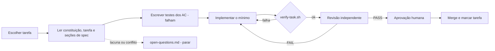

# 05 · Harness de Execução (SDD)

## 1. Objetivo
Garantir que cada tarefa seja implementada **exatamente** como especificado: sem decisões improvisadas, sem escopo extra, com evidência automática e revisão independente.

## 2. Ciclo por tarefa


## 3. Contrato da tarefa (`docs/specs/tasks/T-xxx.md`)
```markdown
---
id: T-xxx
title: <título>
depends_on: [T-...]
covers: [RF-001, RNF-004]
evidence_only: []                # requisitos de covers provados por evidência, sem @Tag (Q-057)
allowed_paths:
  - <glob de arquivos que podem ser criados/alterados>
allowed_new_dependencies: []     # coordenadas Maven permitidas; vazio = nenhuma
---
## Objetivo
## Entradas (specs lidas)
## Saídas (artefatos esperados)
## Critérios de aceite (IDs de 02-requirements + específicos)
## Testes exigidos (por AC)
## Não-objetivos
## Checklist de pronto
- [ ] verify verde  - [ ] evidências registradas  - [ ] README atualizado e comandos executados em bash e PowerShell (ou N/A justificado, Q-054)  - [ ] revisão independente PASS  - [ ] aprovação humana
```

Se a tarefa muda como subir ou usar a aplicação, `README.md` entra nos `allowed_paths` (Q-054).

**Stack isolada para executar o README (Q-054).** Os comandos do README são executados num clone limpo, fora do OneDrive (no Windows, `git -c core.longpaths=true clone`), e numa stack que não é a `fluxo-caixa` do autor:
- `COMPOSE_PROJECT_NAME` próprio (por exemplo, `readme-teste-bash` e `readme-teste-ps`), definido em cada terminal;
- no `.env` do clone, `POSTGRES_PORT`, `KAFKA_PORT` e `KAFKA_UI_PORT` trocados por portas livres;
- os serviços sobem com um `SERVER_PORT` livre, e as chamadas usam essa porta.

Fora isso, os comandos são os do README. Ao fim, só os processos dessas portas são encerrados, por PID, e a stack isolada sai com `down -v`. A evidência registra o *shell*, a versão e o resultado de cada passo executado.

## 4. Gate automático `scripts/verify-task.sh T-xxx` (implementado na T-003)
Falha (exit ≠ 0) se qualquer item falhar; roda todos os itens, mesmo depois de uma falha, e grava `docs/specs/reviews/T-xxx.verify.log` com o resultado de cada um. A base do *diff* é a variável `BASE` (padrão `main`): `git -c core.quotepath=false diff --no-renames --name-only "$BASE"...HEAD`. Se o `main` local estiver defasado, use `BASE=<branch base da tarefa>`.
1. `./mvnw -q verify` verde.
2. **Escopo:** arquivos do *diff* ⊆ `allowed_paths` (exceto `docs/specs/reviews/**` e `docs/specs/traceability.md`, sempre permitidos, Q-068).
3. **Dependências:** nenhuma coordenada nova em `pom.xml` fora de `allowed_new_dependencies`.
4. **Rastreabilidade:** cada ID em `covers` que não está em `evidence_only` aparece em ao menos um `@Tag` de teste alterado/criado no *diff*; e `docs/specs/traceability.md` versionado é igual ao gerado (`scripts/check-traceability.sh --check-file`).
5. **Padrões proibidos** nas linhas adicionadas: `TODO`, `FIXME`, `System.out`, `printStackTrace`, `@Disabled`, `Thread.sleep` em testes.
6. **Artefatos:** arquivos de "Saídas" existem.

### 4.1 Regras de detalhe (Q-057, Q-058, Q-068)
- **Item 2:** *globs* de `allowed_paths` com `*` e `**` casando qualquer sequência, inclusive `/`; comentários `#` no frontmatter são ignorados.
- **Item 3:** coordenada nova = `groupId:artifactId` de um `<dependency>` presente num `pom.xml` em `HEAD` e ausente em todos os `pom.xml` da base. Ela precisa estar em `allowed_new_dependencies`. O inventário `docs/specs/dependency-allowlist.md` lista todas as dependências diretas, com a tarefa ou Q que aprovou, e é atualizado depois do *merge*; o gate não o confere.
- **Item 4:** `evidence_only` (chave do frontmatter, §3) lista os IDs de `covers` provados só por evidência. Obrigatórios com `@Tag`: todos os RF e os RNF-001 a RNF-008 e RNF-012 a RNF-014. Por evidência, sem `@Tag`: RNF-009, RNF-010, RNF-011 e o que a tarefa declarar em `evidence_only`. `docs/specs/traceability.md` é gerado por `scripts/check-traceability.sh --write` e regenerado no PR da tarefa que muda testes com `@Tag`.
- **Item 5:** só nas linhas adicionadas de `*.java`; `Thread.sleep` só em `src/test/**`.
- **Item 6:** os caminhos entre crases na seção "Saídas" que tenham `/` e extensão, e que não sejam *globs*, precisam existir.
- **Testes dos scripts:** `scripts/test/run-tests.sh`, em bash puro, com um repositório Git temporário por cenário.

## 5. Revisão independente
Executada por um revisor **sem o contexto de raciocínio do implementador** (outra sessão/subagente). Entradas: arquivo da tarefa, seções de spec referenciadas, `git diff`, log do `verify-task.sh`. Saída: `docs/specs/reviews/T-xxx.md`. Registros de execução do implementador (evidências) usam `T-xxx.evidence.md`; `T-xxx.md` é exclusivo do revisor independente.

### Rubrica
| # | Item | Falha quando |
|---|---|---|
| R1 | Critérios de aceite | Algum AC sem teste que o prove (citar `classe#método`) |
| R2 | Escopo | Arquivo fora de `allowed_paths` ou funcionalidade não pedida |
| R3 | Decisões não previstas | Qualquer escolha não presente na spec/ADR (deve ser zero) |
| R4 | Dependências | Biblioteca nova sem autorização |
| R5 | Segurança | Falta de filtro por comerciante, validação, log sensível, erro vazando detalhe, segredo |
| R6 | Dinheiro e tempo | `double/float` em valor; `now()` fora do `Clock` |
| R7 | Qualidade dos testes | Teste que passaria com o código quebrado; `sleep`; sem asserção significativa |
| R8 | Arquitetura | Regra ArchUnit contornada; dependência de camada invertida |
| R9 | Observabilidade | Métrica/log previsto em `03 §8` ausente |
| R10 | Documentação | README/OpenAPI/ADR/spec desatualizados pela mudança. Também falha em qualquer um de dois casos (Q-054): (1) um comando do README deixou de funcionar, ou falta um comando para usar o que a tarefa entregou; (2) a tarefa muda como subir ou usar a aplicação, e a evidência não registra os comandos afetados executados em bash **e** em PowerShell numa stack isolada (§3) |

### Modelo do relatório
```markdown
# Revisão T-xxx
Veredito: PASS | PASS_WITH_NOTES | FAIL
## Evidência por AC
| AC | Teste | Resultado |
## Achados
| Sev (bloqueante/nota) | Item da rubrica | Descrição | Arquivo:linha |
## Decisões não previstas encontradas
(nenhuma | lista)
## Follow-ups não bloqueantes
```
`PASS_WITH_NOTES`: notas viram tarefas/issues. `FAIL`: volta à implementação.

## 6. Regras anti-improviso
- Lacuna de spec → registrar em `open-questions.md` (`Q-nnn | tarefa | pergunta | opções | decisão | data`) e **parar**.
- Decisão emergente → ADR em rascunho **antes** do código; só segue após aprovação humana.
- Mudança de spec só por PR próprio, antes da tarefa que depende dela.

## 7. Determinismo
Versões pinadas (BOM + enforcer + tags de imagem); `Clock` e `IdGenerator` fixos em testes; testes de propriedade com semente fixa; Testcontainers com imagens pinadas; *golden files* para OpenAPI e eventos; ordem de testes independente; nenhum teste depende de relógio real ou rede externa.

## 8. Papéis
| Atividade | Agente implementador | Agente revisor | Humano |
|---|---|---|---|
| Escrever/alterar spec | Propõe | — | **Decide** |
| Implementar tarefa | **Executa** | — | — |
| Rodar gate | **Executa** | Confere log | — |
| Revisar | — | **Executa** | — |
| Aprovar/merge | — | — | **Decide** |

## 9. Configuração para Claude Code (opcional)
`CLAUDE.md` importa `AGENTS.md`; subagente `reviewer` em `.claude/agents/reviewer.md` com a rubrica acima e permissão somente de leitura + escrita do relatório; *hooks* para rodar `spotless:apply` após edições. Detalhes na T-003.

## 10. Armadilhas conhecidas do ambiente (Q-056)
Aprendidas nas tarefas anteriores; valem para qualquer agente implementador.
- **Antes de qualquer tarefa:** `./mvnw -q install -DskipTests`, porque o Consolidado depende do artefato `contracts` fora do *reactor*.
- **Gates do `verify`:** SpotBugs `CT_CONSTRUCTOR_THROW` (classe que valida no construtor deve ser `final`); Checkstyle com método ≤ 50 linhas, complexidade ≤ 10 e nomes de método sem acento; Spotless (`./mvnw spotless:apply` antes de commitar).
- **Testcontainers do Kafka:** falha transitória ao subir (código 126); rodar de novo antes de investigar.
- **Testes com token:** um token emitido com o `RelogioFixo` só vale num contexto que também usa o `RelogioFixo`; senão, 401.
- **OneDrive:** nunca `git stash -u` (apaga arquivos não rastreados); clones de teste ficam fora do OneDrive e com `git -c core.longpaths=true clone`.
- **Git Bash:** caminho absoluto passado ao `docker` é convertido pelo MSYS (use `MSYS_NO_PATHCONV=1`); acentos digitados no terminal podem não chegar como UTF-8.
- **PowerShell 5.1:** `curl` é *alias* (use `curl.exe`); JSON na linha perde as aspas (use `-d "@arquivo"`); `bash` é o do WSL (use o caminho do Git Bash).
- **gitleaks:** a regra `generic-api-key` dispara em `Key: <valor>` com entropia > 3,5, inclusive em documentação; cite valores de exemplo sem `: ` logo depois do nome do cabeçalho (Q-055).
- **Stack do autor:** nunca derrubar nem alterar o projeto `fluxo-caixa`; toda verificação de compose usa `COMPOSE_PROJECT_NAME` isolado (§3).
- **Lacuna ou conflito na spec:** parar e registrar em `open-questions.md` (P9). Não decidir sozinho, mesmo que pareça óbvio.
