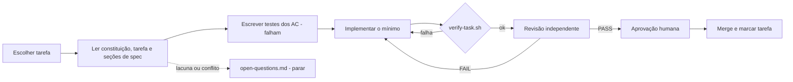

# 05 · Harness de Execução (SDD)

## 1. Objetivo
Garantir que cada tarefa seja implementada **exatamente** como especificado: sem decisões improvisadas, sem escopo extra, com evidência automática e revisão independente.

## 2. Ciclo por tarefa


## 3. Contrato da tarefa (`docs/specs/tasks/T-xxx.md`)
```markdown
---
id: T-xxx
title: <título>
depends_on: [T-...]
covers: [RF-001, RNF-004]
allowed_paths:
  - <glob de arquivos que podem ser criados/alterados>
allowed_new_dependencies: []     # coordenadas Maven permitidas; vazio = nenhuma
---
## Objetivo
## Entradas (specs lidas)
## Saídas (artefatos esperados)
## Critérios de aceite (IDs de 02-requirements + específicos)
## Testes exigidos (por AC)
## Não-objetivos
## Checklist de pronto
```

## 4. Gate automático `scripts/verify-task.sh T-xxx` (especificação do script — implementado na T-003)
Falha (exit ≠ 0) se qualquer item falhar; grava `docs/specs/reviews/T-xxx.verify.log`.
1. `./mvnw -q verify` verde.
2. **Escopo:** `git diff --name-only main...HEAD` ⊆ `allowed_paths` (exceto `docs/specs/reviews/**`).
3. **Dependências:** nenhuma coordenada nova em `pom.xml` fora de `allowed_new_dependencies`.
4. **Rastreabilidade:** cada ID em `covers` aparece em ao menos um `@Tag` de teste alterado/criado.
5. **Padrões proibidos** nas linhas adicionadas: `TODO`, `FIXME`, `System.out`, `printStackTrace`, `@Disabled`, `Thread.sleep` em testes.
6. **Artefatos:** arquivos de "Saídas" existem.

## 5. Revisão independente
Executada por um revisor **sem o contexto de raciocínio do implementador** (outra sessão/subagente). Entradas: arquivo da tarefa, seções de spec referenciadas, `git diff`, log do `verify-task.sh`. Saída: `docs/specs/reviews/T-xxx.md`.

### Rubrica
| # | Item | Falha quando |
|---|---|---|
| R1 | Critérios de aceite | Algum AC sem teste que o prove (citar `classe#método`) |
| R2 | Escopo | Arquivo fora de `allowed_paths` ou funcionalidade não pedida |
| R3 | Decisões não previstas | Qualquer escolha não presente na spec/ADR (deve ser zero) |
| R4 | Dependências | Biblioteca nova sem autorização |
| R5 | Segurança | Falta de filtro por comerciante, validação, log sensível, erro vazando detalhe, segredo |
| R6 | Dinheiro e tempo | `double/float` em valor; `now()` fora do `Clock` |
| R7 | Qualidade dos testes | Teste que passaria com o código quebrado; `sleep`; sem asserção significativa |
| R8 | Arquitetura | Regra ArchUnit contornada; dependência de camada invertida |
| R9 | Observabilidade | Métrica/log previsto em `03 §8` ausente |
| R10 | Documentação | README/OpenAPI/ADR/spec desatualizados pela mudança |

### Modelo do relatório
```markdown
# Revisão T-xxx
Veredito: PASS | PASS_WITH_NOTES | FAIL
## Evidência por AC
| AC | Teste | Resultado |
## Achados
| Sev (bloqueante/nota) | Item da rubrica | Descrição | Arquivo:linha |
## Decisões não previstas encontradas
(nenhuma | lista)
## Follow-ups não bloqueantes
```
`PASS_WITH_NOTES`: notas viram tarefas/issues. `FAIL`: volta à implementação.

## 6. Regras anti-improviso
- Lacuna de spec → registrar em `open-questions.md` (`Q-nnn | tarefa | pergunta | opções | decisão | data`) e **parar**.
- Decisão emergente → ADR em rascunho **antes** do código; só segue após aprovação humana.
- Mudança de spec só por PR próprio, antes da tarefa que depende dela.

## 7. Determinismo
Versões pinadas (BOM + enforcer + tags de imagem); `Clock` e `IdGenerator` fixos em testes; jqwik com semente; Testcontainers com imagens pinadas; *golden files* para OpenAPI e eventos; ordem de testes independente; nenhum teste depende de relógio real ou rede externa.

## 8. Papéis
| Atividade | Agente implementador | Agente revisor | Humano |
|---|---|---|---|
| Escrever/alterar spec | Propõe | — | **Decide** |
| Implementar tarefa | **Executa** | — | — |
| Rodar gate | **Executa** | Confere log | — |
| Revisar | — | **Executa** | — |
| Aprovar/merge | — | — | **Decide** |

## 9. Configuração para Claude Code (opcional)
`CLAUDE.md` importa `AGENTS.md`; subagente `reviewer` em `.claude/agents/reviewer.md` com a rubrica acima e permissão somente de leitura + escrita do relatório; *hooks* para rodar `spotless:apply` após edições. Detalhes na T-003.
